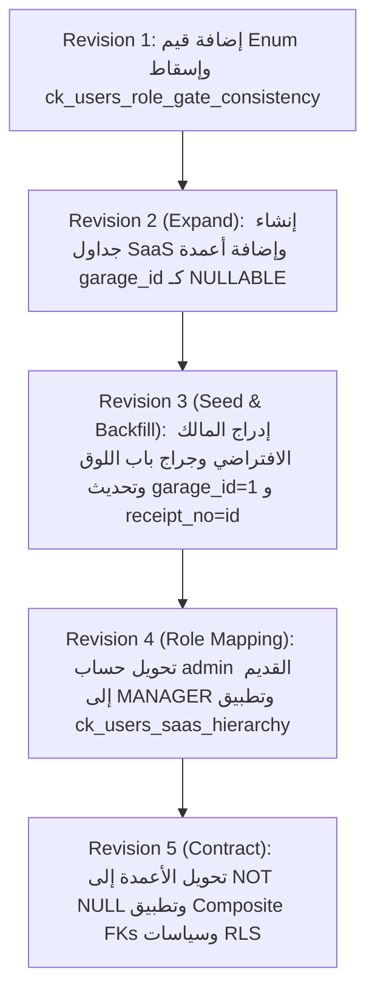

# مواصفة معمارية الانتقال إلى منصة SaaS السحابية متعددة الملاك والمستأجرين
# (Phase 5: Multi-Owner, Multi-Garage, Configuration-Driven SaaS Architecture Spec)

---

## 1. الرؤية المعمارية والأهداف (Architecture Vision & Core Goals)

تهدف هذه الوثيقة إلى وضع المواصفة الهندسية الشاملة والمطابقة للواقع الميداني والتقني لتحويل نظام إدارة الجراجات القائم (PGMS — Garage4U) من نظام جراج فردي مُثبّت محلياً (Single-Tenant / On-Premise) إلى منصة سحابية كخدمة متعددة الملاك ومتعددة الجراجات (**Multi-Tenant, Multi-Owner, Configuration-Driven Cloud SaaS Platform**).

### 1.1 المبادئ الهندسية الحاكمة:
1. **التوافق التام مع الكود المصدري الفعلي وقاعدة البيانات:**  
   - الحفاظ على المعرفات الأساسية (`Primary Keys`) كـ **`Integer / BigInteger`** متوافقة مع نماذج `models/` القائمة، وسجلات التدقيق `audit_logs.entity_id`، وأرقام الإيصالات المطبوعة. يُمنع منعاً باتاً تحويل الـ PKs القائمة إلى UUID.
   - توحيد نوع التواريخ على **`TIMESTAMP WITHOUT TIME ZONE`** (مخزنة بصيغة UTC محايدة) مطابقةً لـ `models/mixins.py`، مع استخدام `zoneinfo.ZoneInfo(garage.timezone)` في طبقة العرض والتقارير.
2. **العزل المنطقي الصارم ومنع الربط العابر للجراجات (Strict Tenant Isolation & Composite Keys):**  
   - اعتماد معمارية قاعدة البيانات المشتركة مع عمود التمييز (`Shared Database with Discriminator Column garage_id`).
   - فرض قيود فريدة مركبة `UNIQUE (id, garage_id)` ومفاتيح خارجية مركبة (`Composite Foreign Keys`) على كافة الجداول التشغيلية لضمان استحالة إشارة جلسة أو وردية في جراج إلى كارت أو تسعيرة أو مستخدم من جراج آخر.
   - فرض سياسات الأمان على مستوى قاعدة البيانات (**PostgreSQL Row-Level Security — RLS**) لكافة الجداول التشغيلية مع دور قاعدة بيانات مخصص غير مميز (`pgms_app`) بدون صلاحية `BYPASSRLS`.
   - ضبط سياق المعاملة عبر الدالة المعتمدة بمحرك asyncpg:  
     `SELECT set_config('app.current_garage_id', $1, true);`  
     بواسطة مستمع أحداث متزامن يقرأ السياق من `session.info`، لضمان عدم تسرب السياق عبر مجمع الاتصالات (`asyncpg connection pool`).
   - توفير سياق نظام صريح (`System Context`) للعمليات الدورية (`Lifespan Background Tasks`)، ومسار المصادقة الأولي قبل تحديد الجراج.
3. **الفصل بين رخص الميزات (Entitlements) وإعدادات التشغيل (Settings):**  
   - الرخص التعاقدية (`Entitlements`) يحددها السوبر أدمن حصراً في جدول `garages` (مثل: `can_use_anpr`, `can_use_subscriptions`, `max_gates`).
   - الإعدادات التشغيلية (`Settings`) يضبطها المالك في حدود رخصته في جدول `garage_configs`.
   - الميزة الفعلية تحسب وقت التشغيل كـ:  
     $$\text{Effective Permission} = \text{Entitlement} \land \text{Setting}$$
4. **التوافق التشغيلي والميداني الواقعي:**  
   - دعم البوابات اليدوية الحالية (`MANUAL_BIDIRECTIONAL`) كنمط تشغيل أساسي يماثل جراج باب اللوق، جنباً إلى جنب مع البوابات المنفصلة والمدمجة (`COMBINED`).
   - دعم التذاكر الورقية المطبوعة (`ticket_code`) إلى جانب الكروت البلاستيكية الذكية (`card_code`).
   - الاعتماد الميداني الأساسي للطباعة على المتصفح المباشر `window.print()` بمقاسات 58mm و 80mm محددة لكل بوابة في `garage_gates.paper_width_mm`.
5. **معمارية آمنة وموزعة لوكلاء الكاميرات (Edge Network):**  
   - جدول مستقل للأجهزة `edge_devices` مربوط بجدول وسيط للبوابات `edge_device_gates` مع دعم اتجاهات التصوير (`ENTRY`, `EXIT`, `BIDIRECTIONAL`) وأجهزة احتياطية متعددة للبوابة الواحدة.
   - توكن مشفر برأس الطلب `X-Edge-Token`.
   - حظر تمرير الصور الثقيلة عبر قنوات `Postgres NOTIFY` (قيد 8KB). رفع الصور يتم عبر مسار مصادق `HTTP POST` بحد أقصى **1,500,000 بايت** مطابق لـ `config.py:30`.
   - في Phase 5، تعتمد المنصة نشر السيرفر الفردي أو المجلد المشترك (`Single-Server / Shared Volume Mount`) تحت مسار معزول `media/garages/{garage_id}/plates/YYYY/MM/` مع تصميم طبقة التخزين عبر واجهة تجريدية `StorageProvider` تمهيداً للتوسع إلى S3/MinIO في النشر السحابي الموزع.

---

## 2. الهيكلية الهرمية للمنصة والممثلون (Platform Hierarchy & System Actors)

```
[ Platform Super Admin ] (Global Platform Administration & Entitlements)
         │
         ▼
[ Garage Owners ] (Company / Investor Level - Fleet Overview & Garage Switcher)
         │
         ├────────────────────────────────┬────────────────────────────────┐
         ▼                                ▼                                ▼
[ Garage 1 (e.g. Babelooq) ]    [ Garage 2 (e.g. Tahrir) ]      [ Garage 3 (e.g. Maadi) ]
   ├── Garage Manager              ├── Garage Manager              ├── Garage Manager
   ├── Gate Operators (1..max)     ├── Gate Operators (1..max)     ├── Gate Operators (1..max)
   └── Edge Devices (LPR Agent)    └── Edge Devices (LPR Agent)    └── [No Cameras - Non-ANPR]
```

### 2.1 أدوار المستخدمين والمصفوفة الهرمية (User Roles Hierarchy)

في قاعدة البيانات، تُخزن الأدوار بنمط Enum المعتمد في `models/user.py` بأحرف كبيرة (`SUPER_ADMIN`, `OWNER`, `MANAGER`, `OPERATOR`):

| الدور (`role`) | النطاق التشغيلي | الحقول الإلزامية في جدول `users` | الوصف والصلاحيات |
| :--- | :--- | :--- | :--- |
| **`SUPER_ADMIN`** | المنصة بالكامل (Global) | `owner_id = NULL`, `garage_id = NULL`, `gate_number = NULL` | إدارة حسابات الملاك، ترخيص ميزات وسعات الجراجات، مراقبة صحة النظام، واستعراض سجل التدقيق العام. |
| **`OWNER`** | أسطول جراجات المالك | `owner_id NOT NULL`, `garage_id = NULL`, `gate_number = NULL` | استعراض لوحة التحكم المجمعة للأسطول، التبديل بين الجراجات، تعيين مديري الجراجات، وضبط الإعدادات. |
| **`MANAGER`** | جراج واحد محدد | `owner_id NOT NULL`, `garage_id NOT NULL`, `gate_number = NULL` | إدارة الورديات، تسعير الجراج، المشتركين، المشغلين، ومراجعة سجلات الجراج الخاص به حصراً. |
| **`OPERATOR`** | جراج وبوابة محددة | `owner_id NOT NULL`, `garage_id NOT NULL`, `gate_number NOT NULL` | تسجيل الحركات الميدانية (دخول/خروج)، تحصيل الرسوم، وفتح/إغلاق الوردية المسندة إليه. |

---

### 2.2 حسم هوية تسجيل الدخول وسياق الـ RLS (Login Identity Resolution & RLS Sequencing)

لمنع أي غموض عند تسجيل الدخول عندما يتكرر اسم مشغل (مثل `ahmed`) في جراجين مختلفين، وبسبب خضوع جدول `audit_logs` لسياسات الـ RLS:
- **شاشة تسجيل الدخول الموحدة:**  
  تحتوي على حقول: `garage_code` (اختياري للسوبر أدمن والمالك، وإلزامي للمدير والمشغل)، `username`، و `password`.
- **تسلسل سياق الجلسة والـ RLS أثناء الدخول:**
  1. تبدأ جلسة الاتصال بقاعدة البيانات في سياق عام غير موثق (`is_system = false, is_super_admin = false, current_garage_id = NULL`).
  2. نظراً لأن جدولي `garages` و `users` مستثنيان صراحة من الـ RLS (`DISABLE ROW LEVEL SECURITY`)، يستعلم مسار الدخول بأمان عن الجراج والمستخدم:
     - إذا أُدخل `garage_code`: التحقق من وجود الجراج `SELECT id, owner_id FROM garages WHERE code = $1` ثم البحث عن المستخدم `SELECT * FROM users WHERE garage_id = $1 AND username = $2`.
     - إذا تُرك `garage_code` فارغاً: البحث في الحسابات العامة للمنصة والمالكين `SELECT * FROM users WHERE garage_id IS NULL AND username = $1 AND role IN ('SUPER_ADMIN', 'OWNER')`.
  3. التحقق من صحة كلمة المرور عبر `AuthService.authenticate_user`.
  4. **ضبط سياق الـ RLS قبل تسجيل التدقيق (Crucial Step):**  
     فور نجاح التحقق، وقبل استدعاء `audit_service.log(...)`، تُحدّث الجلسة سياق الـ RLS على الاتصال:
     - للمشغل أو المدير: ضبط `app.current_garage_id = user.garage_id` و `app.current_owner_id = user.owner_id`.
     - للمالك: ضبط `app.current_owner_id = user.owner_id` و `app.current_garage_id = NULL`.
     - للسوبر أدمن: ضبط `app.is_super_admin = 'true'`.
  5. **تسجيل حدث التدقيق `USER_LOGIN`:**  
     يُكتب سجل التدقيق بنجاح دون اعتراض من الـ RLS.
  6. **في حال فشل المصادقة:**  
     يُسجل حدث `LOGIN_FAILED` بسياق المنصة العام (`entity_type = 'platform'`, `actor_id = NULL`, `garage_id = NULL` أو معرف الجراج المستهدف إن وُجد الكود).
- **تدقيق وصول السوبر أدمن للجراجات (`SUPER_ADMIN_GARAGE_ACCESS`):**  
  كلما قام السوبر أدمن بطلب بيانات جراج محدد، يُسجل فوراً حدث تدقيق على مستوى المنصة (`entity_type = 'platform'`, `action = 'SUPER_ADMIN_GARAGE_ACCESS'`, `actor_id = super_admin.id`, `garage_id = NULL`, `payload_after = {"target_garage_id": target_id}`).
- **دورة تغيير كلمة المرور الإلزامية (`must_change_password`):**  
  إذا كان `user.must_change_password == TRUE`، يُسمح للمستخدم فقط بالوصول لمسار `/auth/change-password` ويُحجب عن كافة المسارات التشغيلية حتى يغير كلمة مروره.

---

## 3. قصص المستخدمين ومعايير القبول (User Stories & Acceptance Criteria)

### US-01: ترخيص باقة الجراج وميزاته (Super Admin)
> **بصفتي** سوبر أدمن للمنصة،  
> **أريد** إنشاء جراج جديد وإسناده لمالك محدد وترخيص ميزاته المسموحة (`can_use_anpr`, `can_use_subscriptions`, `max_gates`)،  
> **حتى** أضمن التزام كل جراج بالباقة التعاقدية ومنع المالك من تفعيل ميزات غير مرخصة.

*معايير القبول (Gherkin):*
- **Given** سوبر أدمن مسجل دخوله في النظام،
- **When** يرسل طلب إنشاء جراج للمالك رقم `5` مع تحديد `can_use_anpr = FALSE` و `max_gates = 2`،
- **Then** يتم إنشاء الجراج وتسجيل رخصه، وإذا حاول المالك لاحقاً تفعيل خيار `anpr_enabled` في إعدادات الجراج، يرفض النظام الطلب بكود خطأ `422 FEATURE_NOT_ENTITLED`.

---

### US-02: استعراض أسطول الجراجات والتبديل بينها (Owner Multi-Garage Management)
> **بصفتي** مالك جراجات،  
> **أريد** لوحة تحكم مركزية لأسطول جراجاتي مع أداة تبديل (`Garage Switcher`) في شريط التنقل،  
> **حتى** أتنقل بين إدارة جراجاتي بسلاسة وأمان مع حماية من هجمات CSRF.

*معايير القبول (Gherkin):*
- **Given** مالك يمتلك جراجين (باب اللوق، والتحرير)،
- **When** يفتح شاشة `/owner/dashboard`،
- **Then** يرى إجمالي الإيرادات المجمعة ونسب الإشغال لكل جراج،  
- **When** يختار "جراج التحرير" من الـ Switcher في واجهة المتصفح،
- **Then** يرسل المتصفح طلب `POST /ui/admin/switch-garage` متضمناً `_csrf_token` صالحة، ليتم تحديث الكوكيز `pgms_active_garage` وإعادة توجيهه إلى `/ui/admin/dashboard`، مع تحقق التبعية في كل طلب من امتلاكه للجراج.

---

### US-03: إدارة تشغيل الجراج المستقل (Garage Manager)
> **بصفتي** مدير جراج،  
> **أريد** إدارة تسعيرة جراجي ومشغليه ومراجعة تقاريره،  
> **حتى** أضمن كفاءة التشغيل دون أدنى إمكانية للاطلاع على بيانات أي جراج آخر أو التأثير عليها.

*معايير القبول (Gherkin):*
- **Given** مدير مسجل لجراج باب اللوق،
- **When** يقوم بتفعيل تسعيرة جديدة لجراجه،
- **Then** تصبح التسعيرة نشطة لجراج باب اللوق حصراً، وتظل تسعيرات باقي جراجات المنصة كما هي دون تغيير،  
- **When** يحاول استعراض جلسات أو مستخدمين عبر الـ API بدون تحديد أو بتحديد معرف جراج آخر،
- **Then** تحجب سياسات الـ RLS وقواعد التحقق كافة السجلات الأجنبية وتعيد `404 TENANT_NOT_FOUND`.

---

### US-04: تشغيل البوابات الميدانية (Gate Operator)
> **بصفتي** مشغل بوابة،  
> **أريد** تسجيل دخول وخروج المركبات وإصدار الإيصالات المرقمة تسلسلياً،  
> **حتى** أتمكن من إنجاز حركات الدخول والخروج في أقل من 150 ملي ثانية دون أي تعطل.

*معايير القبول (Gherkin):*
- **Given** مشغل في وردية مفتوحة على بوابة مدمجة،
- **When** يمسح كارت سيارة للدخول،
- **Then** يتم تخصيص رقم إيصال ذري متسلسل خاص بالجراج `receipt_no` عبر قفل لحظي للعداد لا يتجاوز 3 ملي ثانية، وطباعة التذكرة فوراً،  
- **When** يمسح نفس الكارت بعد دقيقة واحدة،
- **Then** يطلب النظام تأكيداً يدويّاً لمنع الخروج العرضي السريع.

---

### US-05: اتصال وكيل الكاميرات والتعرف على اللوحات (Edge Agent ANPR)
> **بصفتي** جهاز وكيل محلي للكاميرات (Edge Agent)،  
> **أريد** مصافحة الخادم عبر WebSocket بتوكن آمن ورفع الصور الملتقطة عبر مسار HTTP مخصص،  
> **حتى** أزود النظام بقراءات اللوحات دون استنزاف مجمع اتصالات قاعدة البيانات.

*معايير القبول (Gherkin):*
- **Given** جهاز Edge مرخص للبوابتين 1 و 2،
- **When** يتصل بـ `/ws/edge` بترويسة `X-Edge-Token` صالحة،
- **Then** يتحقق السيرفر ويغلق جلسة قاعدة البيانات فوراً، ولا يُرسل للجهاز إلا أوامر التصوير الخاصة بالبوابات المسندة له في جراجه، وعند رفع الصورة عبر `/api/v1/edge/upload-capture` يتم التحقق من ملكية الجلسة وحجم الملف (حد أقصى 1.5 ميجابايت).

---

### US-06: تعديل التكوين التشغيلي بأمان وتدقيق (Configuration Management)
> **بصفتي** مالك جراج،  
> **أريد** تعديل إعدادات التكوين (مثل نوع التذاكر أو صورة الخروج)،  
> **حتى** أتحكم في تشغيل جراجي دون تعديل في الكود المصدري.

*معايير القبول (Gherkin):*
- **Given** مالك جراج يحاول تعديل التكوين،
- **When** يحاول تفعيل `exit_photo_enabled` بينما `anpr_enabled = FALSE`،
- **Then** يرفض النظام الطلب فوراً بخطأ اتساق تشغيلي،  
- **When** يحاول تغيير `ticket_system` وهناك سيارات بالداخل في جلسات `ACTIVE`،
- **Then** يرفض النظام الطلب بكود `409 CONFIG_LOCKED_ACTIVE_SESSIONS` مع تسجيل أي تعديل ناجح في `audit_logs`.

---

## 4. معمارية قاعدة البيانات والتعديلات الهيكلية (Database Architecture & Schema Changes)

> [!WARNING]
> **حالة هندسية نهائية مستهدفة (Target Final Schema State) — للقراءة والتوثيق فقط:**  
> يمثل القسمان 4.2 و 4.3 الحالة الهندسية النهائية المستهدفة (`Target Schema State`) بعد اكتمال كافة مراحل الترحيل.  
> **يُمنع منعاً باتاً تنفيذ أوامر DDL الواردة في هذين القسمين مباشرةً بصيغة `NOT NULL` على قاعدة بيانات تحوي بيانات سابقة**.  
> التنفيذ الفعلي يتم **حصراً** عبر هجرات Alembic الخمس بنمط التوسيع والانكماش (Expand / Contract) المفصلة في القسم 11 ووثيقة `tasks.md` (إضافة كـ Nullable ← ترحيل وملء البيانات Backfill ← ثم التحويل إلى `NOT NULL`).  
> المحرك المعتمد حصراً هو **PostgreSQL 15+**.

### 4.1 أدوار مستخدمي قاعدة البيانات والصلاحيات (Database Roles & Hardened Security)

| دور قاعدة البيانات | الصلاحيات والامتيازات | الاستخدام والغرض |
| :--- | :--- | :--- |
| **`pgms_app`** | `NOSUPERUSER`, `NOBYPASSRLS`. يمتلك `SELECT, INSERT, UPDATE` على الجداول التشغيلية وكافة الجداول (بما فيها `owners`, `garages`, `users` لتمكين إنشاء وتحديث السجلات من قبل السوبر أدمن والمالك مع فرض العزل التام في طبقة التطبيق عبر Scoped Repositories). يمتلك `SELECT, INSERT` على `audit_logs` (ممنوع من `UPDATE/DELETE/TRUNCATE`). ممنوع من `DELETE, TRUNCATE` على `owners, garages, users`. يمتلك `USAGE, SELECT` على كافة الـ Sequences. ممنوع من أي DDL (`CREATE, ALTER, DROP`). | دور الاتصال اليومي لتطبيق FastAPI (عبر `DATABASE_URL`). |
| **`pgms_migrator`** | `NOSUPERUSER`, `BYPASSRLS`. يمتلك كامل صلاحيات DDL و DML. | دور تنفيذ هجرات Alembic، سكريبتات Seed، والنسخ الاحتياطي `pg_dump` (عبر `MIGRATION_DATABASE_URL`). |

#### إدارة الامتيازات والصلاحيات (Two-Phase Privilege Strategy):
1. **التهيئة الأولية (`scripts/setup_db_roles.sql` - المهمة 1.1):** تقتصر على إنشاء الدورين وتعيين الامتيازات الافتراضية للجداول والتسلسلات المستقبلية دون تنفيذ أوامر على جداول غير موجودة:
   ```sql
   GRANT USAGE ON SCHEMA public TO pgms_app;
   ALTER DEFAULT PRIVILEGES FOR ROLE pgms_migrator IN SCHEMA public 
       GRANT SELECT, INSERT, UPDATE ON TABLES TO pgms_app;
   ALTER DEFAULT PRIVILEGES FOR ROLE pgms_migrator IN SCHEMA public 
       GRANT USAGE, SELECT ON SEQUENCES TO pgms_app;
   ```
2. **الامتيازات المشددة النهائية (`scripts/grant_app_privileges.sql` - المهمة 2.6):** تُنفذ بعد اكتمال المراجعة 5 وإنشاء كافة الجداول:
   ```sql
   GRANT USAGE ON SCHEMA public TO pgms_app;
   GRANT USAGE, SELECT ON ALL SEQUENCES IN SCHEMA public TO pgms_app;
   GRANT SELECT, INSERT, UPDATE ON ALL TABLES IN SCHEMA public TO pgms_app;
   REVOKE UPDATE, DELETE, TRUNCATE ON audit_logs FROM pgms_app;
   REVOKE DELETE, TRUNCATE ON owners, garages, users FROM pgms_app;
   REVOKE CREATE, ALTER, DROP ON SCHEMA public FROM pgms_app;
   ```

---

### 4.2 الجداول الجديدة الخاصة بالـ SaaS (New Core DDL Schema)

#### 1. جدول الملاك (`owners`)
```sql
CREATE TABLE owners (
    id SERIAL PRIMARY KEY,
    name VARCHAR(120) NOT NULL,
    company_name VARCHAR(150),
    contact_phone VARCHAR(30) NOT NULL,
    contact_email VARCHAR(120) NOT NULL UNIQUE,
    subscription_plan VARCHAR(40) NOT NULL DEFAULT 'STANDARD', -- BASIC, PRO, ENTERPRISE
    billing_status VARCHAR(30) NOT NULL DEFAULT 'ACTIVE',      -- ACTIVE, TRIAL, PAST_DUE, SUSPENDED, CANCELLED
    max_garages_allowed INTEGER NOT NULL DEFAULT 1 CHECK (max_garages_allowed > 0),
    created_at TIMESTAMP WITHOUT TIME ZONE NOT NULL DEFAULT CURRENT_TIMESTAMP,
    updated_at TIMESTAMP WITHOUT TIME ZONE NOT NULL DEFAULT CURRENT_TIMESTAMP
);

CREATE INDEX idx_owners_email ON owners(contact_email);
CREATE INDEX idx_owners_billing_status ON owners(billing_status);
```

#### 2. جدول الجراجات وحزم الرخص (`garages`)
```sql
CREATE TABLE garages (
    id SERIAL PRIMARY KEY,
    owner_id INTEGER NOT NULL REFERENCES owners(id) ON DELETE RESTRICT,
    code VARCHAR(30) NOT NULL UNIQUE,                       -- كود مختصر عالمي (e.g., 'CAI-01', 'BABELOOQ')
    name VARCHAR(150) NOT NULL,
    address TEXT,
    city VARCHAR(60) NOT NULL DEFAULT 'Cairo',
    capacity INTEGER NOT NULL CHECK (capacity > 0),
    timezone VARCHAR(50) NOT NULL DEFAULT 'Africa/Cairo',   -- المنطقة الزمنية المعتمدة لحساب التقارير والورديات
    currency VARCHAR(10) NOT NULL DEFAULT 'EGP',
    status VARCHAR(30) NOT NULL DEFAULT 'ACTIVE' CHECK (status IN ('ACTIVE', 'SUSPENDED', 'TERMINATED')),
    
    -- رخص المنصة (Entitlements - يحددها السوبر أدمن حصراً)
    can_use_anpr BOOLEAN NOT NULL DEFAULT FALSE,
    can_use_subscriptions BOOLEAN NOT NULL DEFAULT TRUE,
    max_gates SMALLINT NOT NULL DEFAULT 2 CHECK (max_gates BETWEEN 1 AND 10),

    created_at TIMESTAMP WITHOUT TIME ZONE NOT NULL DEFAULT CURRENT_TIMESTAMP,
    updated_at TIMESTAMP WITHOUT TIME ZONE NOT NULL DEFAULT CURRENT_TIMESTAMP,

    CONSTRAINT uq_garages_id_owner UNIQUE (id, owner_id)
);

CREATE INDEX idx_garages_owner_id ON garages(owner_id);
CREATE INDEX idx_garages_code ON garages(code);
CREATE INDEX idx_garages_status ON garages(status);
```

#### 3. جدول عدادات الإيصالات الذرية (`garage_counters`)
لحسم مسألة ترقيم الإيصالات ذرّياً بدون تجميد البوابات، ومع منع الحذف العرضي:
```sql
CREATE TABLE garage_counters (
    garage_id INTEGER PRIMARY KEY REFERENCES garages(id) ON DELETE RESTRICT,
    last_receipt_no INTEGER NOT NULL DEFAULT 0
);
```

#### 4. جدول بوابات الجراج المستقل (`garage_gates`)
```sql
CREATE TABLE garage_gates (
    id SERIAL PRIMARY KEY,
    garage_id INTEGER NOT NULL REFERENCES garages(id) ON DELETE RESTRICT,
    gate_number SMALLINT NOT NULL CHECK (gate_number BETWEEN 1 AND 10),
    name VARCHAR(60) NOT NULL,
    gate_type VARCHAR(30) NOT NULL DEFAULT 'MANUAL_BIDIRECTIONAL', 
    -- 'ENTRY_ONLY', 'EXIT_ONLY', 'COMBINED', 'MANUAL_BIDIRECTIONAL'
    default_terminal_profile VARCHAR(30) NOT NULL DEFAULT 'DESKTOP_PC',
    -- 'DESKTOP_PC', 'SUNMI_POS', 'MOBILE_WEB'
    paper_width_mm SMALLINT NOT NULL DEFAULT 80 CHECK (paper_width_mm IN (58, 80)),
    created_at TIMESTAMP WITHOUT TIME ZONE NOT NULL DEFAULT CURRENT_TIMESTAMP,
    
    CONSTRAINT uq_garage_gate_number UNIQUE (garage_id, gate_number),
    CONSTRAINT uq_garage_gates_id_garage UNIQUE (id, garage_id)
);

CREATE INDEX idx_garage_gates_lookup ON garage_gates(garage_id, gate_number);
```

#### 5. جدول أجهزة وكلاء الكاميرات المحمية (`edge_devices`)
```sql
CREATE TABLE edge_devices (
    id SERIAL PRIMARY KEY,
    garage_id INTEGER NOT NULL REFERENCES garages(id) ON DELETE RESTRICT,
    device_name VARCHAR(80) NOT NULL,                      -- اسم الحاسوب المحلي (e.g., 'Gate 1-2 AI Workstation')
    token_hash VARCHAR(128) NOT NULL UNIQUE,                -- تجزئة SHA-256 للتوكن الصادر للجهاز
    revoked_at TIMESTAMP WITHOUT TIME ZONE,                -- الجهاز نشط طالما revoked_at IS NULL
    last_seen_at TIMESTAMP WITHOUT TIME ZONE,
    created_at TIMESTAMP WITHOUT TIME ZONE NOT NULL DEFAULT CURRENT_TIMESTAMP,

    CONSTRAINT uq_edge_devices_id_garage UNIQUE (id, garage_id)
);

CREATE INDEX idx_edge_devices_garage ON edge_devices(garage_id);
```

#### 6. جدول ربط أجهزة الكاميرات بالبوابات المخدومة (`edge_device_gates`)
تصميم مرن يدعم كاميرات متعددة للبوابة الواحدة (كاميرا دخول + كاميرا خروج) أو أجهزة احتياطية، مع قيود صارمة على الحذف (`RESTRICT`):
```sql
CREATE TABLE edge_device_gates (
    id SERIAL PRIMARY KEY,
    device_id INTEGER NOT NULL,
    garage_id INTEGER NOT NULL,
    gate_number SMALLINT NOT NULL,
    direction VARCHAR(15) NOT NULL DEFAULT 'BIDIRECTIONAL' 
        CHECK (direction IN ('ENTRY', 'EXIT', 'BIDIRECTIONAL')),
    is_active BOOLEAN NOT NULL DEFAULT TRUE,
    created_at TIMESTAMP WITHOUT TIME ZONE NOT NULL DEFAULT CURRENT_TIMESTAMP,

    CONSTRAINT uq_device_gate_direction UNIQUE (device_id, garage_id, gate_number, direction),
    CONSTRAINT uq_gate_direction_active UNIQUE (garage_id, gate_number, direction),
    CONSTRAINT fk_edg_device FOREIGN KEY (device_id, garage_id) 
        REFERENCES edge_devices(id, garage_id) ON DELETE RESTRICT,
    CONSTRAINT fk_edg_gate FOREIGN KEY (garage_id, gate_number) 
        REFERENCES garage_gates(garage_id, gate_number) ON DELETE RESTRICT
);

CREATE INDEX idx_edg_lookup ON edge_device_gates(garage_id, gate_number);
```

#### 7. جدول تكوين الجراج الديناميكي (`garage_configs`)
```sql
CREATE TABLE garage_configs (
    id SERIAL PRIMARY KEY,
    garage_id INTEGER NOT NULL UNIQUE REFERENCES garages(id) ON DELETE RESTRICT,
    
    -- إعدادات التشغيل (Settings - يضبطها المالك في حدود الـ Entitlements)
    ticket_system VARCHAR(30) NOT NULL DEFAULT 'REUSABLE_CARDS', 
    -- 'REUSABLE_CARDS' أو 'PAPER_BARCODE_TICKETS'
    anpr_enabled BOOLEAN NOT NULL DEFAULT FALSE,
    exit_photo_enabled BOOLEAN NOT NULL DEFAULT FALSE,
    subscriptions_enabled BOOLEAN NOT NULL DEFAULT TRUE,
    require_shift_cash_reconciliation BOOLEAN NOT NULL DEFAULT TRUE,
    min_session_duration_seconds SMALLINT NOT NULL DEFAULT 60 
        CHECK (min_session_duration_seconds BETWEEN 30 AND 600),
    
    -- إعدادات نصوص الإيصال الميداني
    receipt_settings JSONB NOT NULL DEFAULT '{
        "header_title": "جراج سيارات",
        "header_subtitle": "أهلاً بكم",
        "footer_terms": "الجراج غير مسؤول عن محتويات السيارات الداخلية",
        "show_qr_code": true
    }'::jsonb,

    version INTEGER NOT NULL DEFAULT 1,                      -- Optimistic Locking
    updated_at TIMESTAMP WITHOUT TIME ZONE NOT NULL DEFAULT CURRENT_TIMESTAMP,

    CONSTRAINT uq_garage_configs_id_garage UNIQUE (id, garage_id)
);

CREATE INDEX idx_garage_configs_garage ON garage_configs(garage_id);
```

---

### 4.3 تعديل الجداول التشغيلية القائمة وتطبيق الـ Composite Foreign Keys الكاملة

لضمان منع أي إشارة عابرة للجراجات على مستوى محرك قاعدة البيانات:

#### 1. جدول المستخدمين (`users`):
```sql
ALTER TABLE users ADD COLUMN owner_id INTEGER;
ALTER TABLE users ADD COLUMN garage_id INTEGER;
ALTER TABLE users ADD COLUMN must_change_password BOOLEAN NOT NULL DEFAULT FALSE;

ALTER TABLE users ADD CONSTRAINT fk_users_owner FOREIGN KEY (owner_id) 
    REFERENCES owners(id) ON DELETE RESTRICT;
ALTER TABLE users ADD CONSTRAINT fk_users_garage_owner FOREIGN KEY (garage_id, owner_id) 
    REFERENCES garages(id, owner_id) ON DELETE RESTRICT;

ALTER TABLE users ADD CONSTRAINT uq_users_id_garage UNIQUE (id, garage_id);

ALTER TABLE users DROP CONSTRAINT IF EXISTS users_username_key;
ALTER TABLE users ADD CONSTRAINT uq_users_garage_username UNIQUE (garage_id, username);
CREATE UNIQUE INDEX uq_global_users_username ON users(username) WHERE garage_id IS NULL;

-- ملاحظة: يتم إسقاط ck_users_role_gate_consistency في Revision 1 قبل ترحيل البيانات، ثم يُطبق القيد الجديد:
ALTER TABLE users ADD CONSTRAINT ck_users_saas_hierarchy CHECK (
    (role = 'SUPER_ADMIN' AND owner_id IS NULL AND garage_id IS NULL AND gate_number IS NULL) OR
    (role = 'OWNER' AND owner_id IS NOT NULL AND garage_id IS NULL AND gate_number IS NULL) OR
    (role = 'MANAGER' AND owner_id IS NOT NULL AND garage_id IS NOT NULL AND gate_number IS NULL) OR
    (role = 'OPERATOR' AND owner_id IS NOT NULL AND garage_id IS NOT NULL AND gate_number IS NOT NULL AND gate_number BETWEEN 1 AND 10)
);

CREATE INDEX idx_users_garage_lookup ON users(garage_id, role);
```

#### 2. جدول بطاقات الجراج (`parking_cards`):
```sql
ALTER TABLE parking_cards ADD COLUMN garage_id INTEGER NOT NULL REFERENCES garages(id) ON DELETE RESTRICT;

ALTER TABLE parking_cards DROP CONSTRAINT IF EXISTS parking_cards_card_code_key;
ALTER TABLE parking_cards ADD CONSTRAINT uq_garage_card_code UNIQUE (garage_id, card_code);
ALTER TABLE parking_cards ADD CONSTRAINT uq_parking_cards_id_garage UNIQUE (id, garage_id);

CREATE INDEX idx_parking_cards_garage_status ON parking_cards(garage_id, status);
```

#### 3. جدول الورديات (`shifts`):
مطابقة الحقول القائمة في `models/shift.py` (`id`, `operator_id`, `gate_number`, `started_at`, `ended_at`, `opening_cash_egp`, `closing_cash_egp`, `notes`, `admin_override_note`):
```sql
ALTER TABLE shifts ADD COLUMN garage_id INTEGER NOT NULL REFERENCES garages(id) ON DELETE RESTRICT;

ALTER TABLE shifts ADD CONSTRAINT fk_shifts_operator_garage FOREIGN KEY (operator_id, garage_id) 
    REFERENCES users(id, garage_id) ON DELETE RESTRICT;
ALTER TABLE shifts ADD CONSTRAINT fk_shifts_gate_garage FOREIGN KEY (garage_id, gate_number) 
    REFERENCES garage_gates(garage_id, gate_number) ON DELETE RESTRICT;

ALTER TABLE shifts ADD CONSTRAINT uq_shifts_id_garage UNIQUE (id, garage_id);

CREATE INDEX idx_shifts_garage_lookup ON shifts(garage_id, started_at);
CREATE INDEX idx_shifts_garage_active ON shifts(garage_id, gate_number) WHERE ended_at IS NULL;
```

#### 4. جدول قواعد التسعير (`pricing_rules`):
```sql
ALTER TABLE pricing_rules ADD COLUMN garage_id INTEGER NOT NULL REFERENCES garages(id) ON DELETE RESTRICT;

ALTER TABLE pricing_rules ADD CONSTRAINT fk_pricing_created_by FOREIGN KEY (created_by, garage_id) 
    REFERENCES users(id, garage_id) ON DELETE RESTRICT;

ALTER TABLE pricing_rules ADD CONSTRAINT uq_garage_pricing_label UNIQUE (garage_id, label);
ALTER TABLE pricing_rules ADD CONSTRAINT uq_pricing_rules_id_garage UNIQUE (id, garage_id);

CREATE INDEX idx_pricing_rules_garage ON pricing_rules(garage_id);
CREATE INDEX idx_pricing_rules_active ON pricing_rules(garage_id) WHERE is_active = TRUE;
```

#### 5. جدول جلسات الاصطفاف (`parking_sessions`):
مطابقة الحقول القائمة في `models/parking_session.py` وتطبيق القيود المركبة:
```sql
ALTER TABLE parking_sessions ADD COLUMN garage_id INTEGER NOT NULL REFERENCES garages(id) ON DELETE RESTRICT;
ALTER TABLE parking_sessions ADD COLUMN receipt_no INTEGER NOT NULL;
ALTER TABLE parking_sessions ADD COLUMN ticket_code VARCHAR(50);

ALTER TABLE parking_sessions ALTER COLUMN card_id DROP NOT NULL;
ALTER TABLE parking_sessions ALTER COLUMN card_code DROP NOT NULL;

ALTER TABLE parking_sessions ADD CONSTRAINT ck_session_card_or_ticket CHECK (
    (card_id IS NOT NULL AND card_code IS NOT NULL) OR (ticket_code IS NOT NULL)
);

ALTER TABLE parking_sessions ADD CONSTRAINT uq_garage_ticket_code UNIQUE (garage_id, ticket_code);
ALTER TABLE parking_sessions ADD CONSTRAINT uq_garage_receipt_no UNIQUE (garage_id, receipt_no);

-- مفاتيح مركبة شاملة لكافة العلاقات المرجعية:
ALTER TABLE parking_sessions ADD CONSTRAINT fk_sessions_card_garage FOREIGN KEY (card_id, garage_id) 
    REFERENCES parking_cards(id, garage_id) ON DELETE RESTRICT;
ALTER TABLE parking_sessions ADD CONSTRAINT fk_sessions_entry_shift_garage FOREIGN KEY (shift_id, garage_id) 
    REFERENCES shifts(id, garage_id) ON DELETE RESTRICT;
ALTER TABLE parking_sessions ADD CONSTRAINT fk_sessions_exit_shift_garage FOREIGN KEY (exit_shift_id, garage_id) 
    REFERENCES shifts(id, garage_id) ON DELETE RESTRICT;
ALTER TABLE parking_sessions ADD CONSTRAINT fk_sessions_pricing_garage FOREIGN KEY (pricing_rule_id, garage_id) 
    REFERENCES pricing_rules(id, garage_id) ON DELETE RESTRICT;
ALTER TABLE parking_sessions ADD CONSTRAINT fk_sessions_operator_garage FOREIGN KEY (operator_id, garage_id) 
    REFERENCES users(id, garage_id) ON DELETE RESTRICT;
ALTER TABLE parking_sessions ADD CONSTRAINT fk_sessions_exit_operator_garage FOREIGN KEY (exit_operator_id, garage_id) 
    REFERENCES users(id, garage_id) ON DELETE RESTRICT;
ALTER TABLE parking_sessions ADD CONSTRAINT fk_sessions_admin_override_garage FOREIGN KEY (admin_override_by, garage_id) 
    REFERENCES users(id, garage_id) ON DELETE RESTRICT;
ALTER TABLE parking_sessions ADD CONSTRAINT fk_sessions_gate_garage FOREIGN KEY (garage_id, gate_number) 
    REFERENCES garage_gates(garage_id, gate_number) ON DELETE RESTRICT;

-- الفهرس الجزئي الدقيق للكروت النشطة داخل نفس الجراج:
DROP INDEX IF EXISTS idx_active_card_id;
CREATE UNIQUE INDEX idx_garage_active_card_id ON parking_sessions (garage_id, card_id) 
WHERE status = 'ACTIVE' AND card_id IS NOT NULL;

CREATE INDEX idx_sessions_garage_status ON parking_sessions(garage_id, status);
CREATE INDEX idx_sessions_garage_entry_time ON parking_sessions(garage_id, entry_time);
CREATE INDEX idx_sessions_garage_plate ON parking_sessions(garage_id, plate_number);
```

#### 6. جداول المشتركين والاشتراكات (`subscribers`, `subscription_plans`, `subscriptions`):
الحقل `subscribers.card_code` تم التحقق من وجوده الفعلي في الكود (`models/subscriber.py:15` وهجرة Alembic `7f2e1a9d4b83` مع الفهرس `ix_subscribers_card_code`):
```sql
ALTER TABLE subscribers ADD COLUMN garage_id INTEGER NOT NULL REFERENCES garages(id) ON DELETE RESTRICT;
ALTER TABLE subscription_plans ADD COLUMN garage_id INTEGER NOT NULL REFERENCES garages(id) ON DELETE RESTRICT;
ALTER TABLE subscriptions ADD COLUMN garage_id INTEGER NOT NULL REFERENCES garages(id) ON DELETE RESTRICT;

-- إسقاط القيود العالمية القائمة واستبدالها بقيود معزولة بالجراج:
ALTER TABLE subscribers DROP CONSTRAINT IF EXISTS subscribers_plate_number_key;
DROP INDEX IF EXISTS ix_subscribers_card_code;

ALTER TABLE subscribers ADD CONSTRAINT uq_garage_subscriber_plate UNIQUE (garage_id, plate_number);
CREATE UNIQUE INDEX uq_garage_subscriber_card ON subscribers(garage_id, card_code) WHERE card_code IS NOT NULL;
ALTER TABLE subscribers ADD CONSTRAINT uq_subscribers_id_garage UNIQUE (id, garage_id);

ALTER TABLE subscription_plans DROP CONSTRAINT IF EXISTS subscription_plans_label_key;
ALTER TABLE subscription_plans ADD CONSTRAINT uq_garage_plan_label UNIQUE (garage_id, label);
ALTER TABLE subscription_plans ADD CONSTRAINT uq_subscription_plans_id_garage UNIQUE (id, garage_id);
ALTER TABLE subscription_plans ADD CONSTRAINT fk_plans_created_by FOREIGN KEY (created_by, garage_id) 
    REFERENCES users(id, garage_id) ON DELETE RESTRICT;

-- مفاتيح مركبة لجدول الاشتراكات:
ALTER TABLE subscriptions ADD CONSTRAINT fk_subscriptions_subscriber_garage FOREIGN KEY (subscriber_id, garage_id) 
    REFERENCES subscribers(id, garage_id) ON DELETE RESTRICT;
ALTER TABLE subscriptions ADD CONSTRAINT fk_subscriptions_plan_garage FOREIGN KEY (plan_id, garage_id) 
    REFERENCES subscription_plans(id, garage_id) ON DELETE RESTRICT;
ALTER TABLE subscriptions ADD CONSTRAINT fk_subscriptions_card_garage FOREIGN KEY (card_id, garage_id) 
    REFERENCES parking_cards(id, garage_id) ON DELETE RESTRICT;
ALTER TABLE subscriptions ADD CONSTRAINT fk_subscriptions_collected_by FOREIGN KEY (collected_by, garage_id) 
    REFERENCES users(id, garage_id) ON DELETE RESTRICT;
ALTER TABLE subscriptions ADD CONSTRAINT fk_subscriptions_prev_sub FOREIGN KEY (previous_subscription_id, garage_id) 
    REFERENCES subscriptions(id, garage_id) ON DELETE RESTRICT;

ALTER TABLE subscriptions ADD CONSTRAINT uq_subscriptions_id_garage UNIQUE (id, garage_id);

-- ربط الجلسات بالاشتراك المركب:
ALTER TABLE parking_sessions ADD CONSTRAINT fk_sessions_subscription_garage FOREIGN KEY (subscription_id, garage_id) 
    REFERENCES subscriptions(id, garage_id) ON DELETE RESTRICT;

CREATE INDEX idx_subscribers_garage ON subscribers(garage_id);
CREATE INDEX idx_subscription_plans_garage ON subscription_plans(garage_id);
CREATE INDEX idx_subscriptions_garage_status ON subscriptions(garage_id, status);
```

#### 7. جدول سجل التدقيق (`audit_logs`):
تعديل `actor_id` ليصبح **`nullable=True`** للأحداث المؤتمتة الصادرة عن السيرفر ومحاولات الدخول الفاشلة، مع إضافة `actor_type`:
```sql
ALTER TABLE audit_logs ALTER COLUMN actor_id DROP NOT NULL;
ALTER TABLE audit_logs ADD COLUMN actor_type VARCHAR(20) NOT NULL DEFAULT 'user'
    CHECK (actor_type IN ('user', 'system', 'edge_device'));
ALTER TABLE audit_logs ADD COLUMN garage_id INTEGER REFERENCES garages(id) ON DELETE RESTRICT;
ALTER TABLE audit_logs ADD COLUMN owner_id INTEGER REFERENCES owners(id) ON DELETE RESTRICT;

-- قيد فحص يضمن وجود garage_id لجميع الأحداث التشغيلية، ويسمح بـ NULL للأحداث العامة:
ALTER TABLE audit_logs ADD CONSTRAINT ck_audit_garage_context CHECK (
    (garage_id IS NOT NULL) OR
    (garage_id IS NULL AND (
        entity_type IN ('platform', 'owner_account', 'system') OR
        actor_type = 'system' OR
        action IN ('USER_LOGIN', 'USER_LOGOUT', 'LOGIN_FAILED', 'SUPER_ADMIN_GARAGE_ACCESS')
    ))
);

CREATE INDEX idx_audit_logs_garage_time ON audit_logs(garage_id, created_at DESC);
CREATE INDEX idx_audit_logs_owner_time ON audit_logs(owner_id, created_at DESC);
```

---

### 4.4 معمارية توليد أرقام الإيصالات (`receipt_no`) وفصل زمن حجز القفل

- **تسلسل التنفيذ خارج المعاملة وداخلها:**
  1. معالجة طلب الدخول والتحقق من الكارت والتقاط الصورة يتم بالكامل **خارج** المعاملة المالية.
  2. فتح المعاملة المالية وقفل العداد ذرّياً:
     ```sql
     UPDATE garage_counters 
     SET last_receipt_no = last_receipt_no + 1 
     WHERE garage_id = :current_garage_id 
     RETURNING last_receipt_no;
     ```
  3. تنفيذ `INSERT INTO parking_sessions (...) VALUES (..., :last_receipt_no)`.
  4. تنفيذ `COMMIT` فوري للمعاملة.
  - **زمن حجز القفل (`Lock Holding Time`):** يقتصر حجز القفل الحصري على أقل من **3 ملي ثانية**، مما يلغي تماماً أي عنق زجاجة بين بوابات الجراج المتزامنة.
- **تحديث قوالب الطباعة الحرارية:**  
  يتم تحديث قوالب الإيصالات `templates/receipts/thermal.html` لتطبع `session.receipt_no` بدلاً من `session.id | zfill(8)`.
- **في الجلسات السابقة لجراج باب اللوق (Backfill):**  
  يتم ضبط `receipt_no = id`، وضبط `garage_counters.last_receipt_no = MAX(id)`، مما يحافظ تماماً على تسلسل الأرقام المطبوعة على الإيصالات الورقية دون أي انقطاع.

---

### 4.5 سياسات أمان قاعدة البيانات الكاملة (Complete PostgreSQL Row-Level Security)

#### 1. الجداول الخاضعة لـ RLS وتفعيل الفرض الإلزامي (11 جدولاً):
تخضع كافة الجداول الـ 11 التشغيلية التي تحتوي على عمود `garage_id` للـ RLS:
`parking_sessions`, `parking_cards`, `shifts`, `pricing_rules`, `subscribers`, `subscription_plans`, `subscriptions`, `garage_gates`, `edge_device_gates`, `garage_configs`, `audit_logs`.

```sql
ALTER TABLE parking_sessions ENABLE ROW LEVEL SECURITY;
ALTER TABLE parking_sessions FORCE ROW LEVEL SECURITY;

ALTER TABLE parking_cards ENABLE ROW LEVEL SECURITY;
ALTER TABLE parking_cards FORCE ROW LEVEL SECURITY;

ALTER TABLE shifts ENABLE ROW LEVEL SECURITY;
ALTER TABLE shifts FORCE ROW LEVEL SECURITY;

ALTER TABLE pricing_rules ENABLE ROW LEVEL SECURITY;
ALTER TABLE pricing_rules FORCE ROW LEVEL SECURITY;

ALTER TABLE subscribers ENABLE ROW LEVEL SECURITY;
ALTER TABLE subscribers FORCE ROW LEVEL SECURITY;

ALTER TABLE subscription_plans ENABLE ROW LEVEL SECURITY;
ALTER TABLE subscription_plans FORCE ROW LEVEL SECURITY;

ALTER TABLE subscriptions ENABLE ROW LEVEL SECURITY;
ALTER TABLE subscriptions FORCE ROW LEVEL SECURITY;

ALTER TABLE garage_gates ENABLE ROW LEVEL SECURITY;
ALTER TABLE garage_gates FORCE ROW LEVEL SECURITY;

ALTER TABLE edge_device_gates ENABLE ROW LEVEL SECURITY;
ALTER TABLE edge_device_gates FORCE ROW LEVEL SECURITY;

ALTER TABLE garage_configs ENABLE ROW LEVEL SECURITY;
ALTER TABLE garage_configs FORCE ROW LEVEL SECURITY;

ALTER TABLE audit_logs ENABLE ROW LEVEL SECURITY;
ALTER TABLE audit_logs FORCE ROW LEVEL SECURITY;
```

#### 2. الجداول المستثناة من RLS ولماذا (5 جداول):
- **`owners`:** جدول عام للمنصة، يُدار بالسوبر أدمن ومقيد بالاستعلامات المباشرة `WHERE id = current_user.owner_id`.
- **`garages`:** مستثنى لأن فحص الصلاحية وقراءة `garage.status` مطلوب قبل إنشاء سياق الجراج، وللبحث عن الجراج بكوده `code`.
- **`users`:** مستثنى لأن عملية تسجيل الدخول تبحث عن المستخدم وتتحقق من هويته بالاسم قبل معرفة الجراج أو إنشاء سياق الجلسة. يتم تأمين جدول `users` عبر الـ Scoped Repositories البرمجية التي تلزم بوجود `WHERE garage_id = :gid`.
- **`garage_counters`:** يُدار حصراً باستعلام ذري مرمز داخل دالة الـ Service داخل المعاملة.
- **`edge_devices` (قرار معماري حاسم):** مستثنى لأن وكلاء الكاميرات عند مصافحة الـ WebSocket أو رفع الصور عبر `/api/v1/edge/upload-capture` يرسلون التوكن في `X-Edge-Token` ويجب البحث عن الجهاز بالـ `token_hash` قبل معرفة الجراج التابع له وقبل إمكانية ضبط سياق المعاملة. تفعيل الـ RLS عليه كان سيعيد 0 صفوف دائماً ويعطل الكاميرات بالكامل. يتم تأمين جدول `edge_devices` عبر القيد الفريد `token_hash VARCHAR(64) UNIQUE NOT NULL`، وفور مطابقة التوكن يتم استخراج `device.garage_id` وضبط سياق الجراج فوراً على الجلسة لتخضع كافة العمليات التالية (`edge_device_gates`, `parking_sessions`, `audit_logs`) للـ RLS الكامل. وفي مسارات إدارة الكاميرات للمديرين والملاك يُلزم المستودع بشرط `WHERE garage_id = :gid`.

#### 3. السياسات الصريحة المحددة بالاسم لكل جدول (Inline Safe Casting):

```sql
-- 1. السياسة الموحدة للجداول التشغيلية العشرة (تطبق لكل جدول باسم صريح):
-- rls_policy_sessions ON parking_sessions
-- rls_policy_cards ON parking_cards
-- rls_policy_shifts ON shifts
-- rls_policy_rates ON pricing_rules
-- rls_policy_subscribers ON subscribers
-- rls_policy_plans ON subscription_plans
-- rls_policy_subs ON subscriptions
-- rls_policy_gates ON garage_gates
-- rls_policy_edge_gates ON edge_device_gates
-- rls_policy_configs ON garage_configs

CREATE POLICY rls_policy_sessions ON parking_sessions FOR ALL
    USING (
        CURRENT_SETTING('app.is_super_admin', TRUE) = 'true'
        OR CURRENT_SETTING('app.is_system_context', TRUE) = 'true'
        OR garage_id = NULLIF(CURRENT_SETTING('app.current_garage_id', TRUE), '')::INTEGER
        OR (
            NULLIF(CURRENT_SETTING('app.current_owner_id', TRUE), '') IS NOT NULL
            AND garage_id IN (
                SELECT id FROM garages WHERE owner_id = NULLIF(CURRENT_SETTING('app.current_owner_id', TRUE), '')::INTEGER
            )
        )
    )
    WITH CHECK (
        CURRENT_SETTING('app.is_super_admin', TRUE) = 'true'
        OR CURRENT_SETTING('app.is_system_context', TRUE) = 'true'
        OR garage_id = NULLIF(CURRENT_SETTING('app.current_garage_id', TRUE), '')::INTEGER
    );

-- (تكرر السياسة بنفس الهيكل للجداول التسعة الأخرى: rls_policy_cards, rls_policy_shifts, rls_policy_rates, rls_policy_subscribers, rls_policy_plans, rls_policy_subs, rls_policy_gates, rls_policy_edge_gates, rls_policy_configs).

-- 2. سياسة خاصة بجدول سجل التدقيق (audit_logs) تتيح استعراض وتوثيق أحداث المنصة العامة والمالكين:
CREATE POLICY rls_policy_audit ON audit_logs FOR ALL
    USING (
        CURRENT_SETTING('app.is_super_admin', TRUE) = 'true'
        OR CURRENT_SETTING('app.is_system_context', TRUE) = 'true'
        OR (garage_id IS NOT NULL AND garage_id = NULLIF(CURRENT_SETTING('app.current_garage_id', TRUE), '')::INTEGER)
        OR (
            NULLIF(CURRENT_SETTING('app.current_owner_id', TRUE), '') IS NOT NULL
            AND (
                owner_id = NULLIF(CURRENT_SETTING('app.current_owner_id', TRUE), '')::INTEGER
                OR garage_id IN (
                    SELECT id FROM garages WHERE owner_id = NULLIF(CURRENT_SETTING('app.current_owner_id', TRUE), '')::INTEGER
                )
            )
        )
    )
    WITH CHECK (
        CURRENT_SETTING('app.is_super_admin', TRUE) = 'true'
        OR CURRENT_SETTING('app.is_system_context', TRUE) = 'true'
        OR (garage_id IS NOT NULL AND garage_id = NULLIF(CURRENT_SETTING('app.current_garage_id', TRUE), '')::INTEGER)
        OR (garage_id IS NULL AND (CURRENT_SETTING('app.is_super_admin', TRUE) = 'true' OR CURRENT_SETTING('app.current_owner_id', TRUE) IS NOT NULL))
    );
```

#### 4. إدارة سياق الـ Session عبر `after_begin`:
- تبعية `get_tenant_context` في FastAPI هي المسؤولة عن حقن السياق في كل طلب:
  - `session.info["garage_id"] = tenant.garage_id`
  - `session.info["owner_id"] = tenant.owner_id`
  - `session.info["is_super_admin"] = tenant.is_super_admin`
  - `session.info["is_system"] = tenant.is_system`
- عند إطلاق حدث `after_begin` المتزامن في SQLAlchemy، يُقرأ السياق من `session.info` مع تحويل القيم الخالية إلى نص فارغ `''` صراحةً لتجنب أخطاء asyncpg عند معالجة الـ NULL:
  ```python
  garage_id_str = str(info.get("garage_id")) if info.get("garage_id") is not None else ""
  owner_id_str = str(info.get("owner_id")) if info.get("owner_id") is not None else ""
  is_super_admin_str = "true" if info.get("is_super_admin") else "false"
  is_system_str = "true" if (info.get("is_system") or info.get("is_system_context")) else "false"

  # تنفيذ استعلام موحد مدمج عبر معايير SQLAlchemy النصية:
  connection.execute(
      text("""
          SELECT 
              set_config('app.current_garage_id', :gid, true),
              set_config('app.current_owner_id', :oid, true),
              set_config('app.is_super_admin', :isa, true),
              set_config('app.is_system_context', :sys, true);
      """),
      {"gid": garage_id_str, "oid": owner_id_str, "isa": is_super_admin_str, "sys": is_system_str}
  )
  ```
- **تطابق التسميات:** التسمية البرمجية في `session.info` هي `"is_system"`، وتطابق المتغير البيئي في قاعدة البيانات `'app.is_system_context'`.
- المعامل الأخير `true` يجعل الإعدادات محلية على مستوى المعاملة الحالية فقط وتُصفَّر تلقائياً فور الـ Commit أو الـ Rollback.
- **سياق النظام (System Tasks & Lifespan):**  
  عند تشغيل مهام الـ Lifespan (مثل فحص انتهاء الاشتراكات في `main.py`)، تضبط الجلسة `session.info['is_system'] = True` ليتم تنفيذ `SELECT set_config('app.is_system_context', 'true', true);`، مع تسجيل أحداث التدقيق بـ `actor_id = NULL` و `actor_type = 'system'`.

---

## 5. استراتيجية تحديد المستأجر وحقن التبعيات (Tenant Resolution Architecture)

### 5.1 عائلات المسارات والنمط الهجين للمالك (Hybrid Path/Cookie Pattern)

يتم تقسيم المسارات هندسياً إلى عائلتين واضحتين:

#### العائلة الأولى: مسارات التشغيل الميداني المعزولة ضمنياً (`Scoped Operational Routes`)
- **المسارات:** `/ui/operator/*`, `/api/v1/sessions/*`, `/api/v1/shifts/*`, `/api/v1/cards/*`
- **المستخدمون:** `OPERATOR` و `MANAGER`.
- **آلية التحديد:** لا يوجد `{garage_id}` في مسار الرابط؛ يُستخرج الجراج حصراً من سجل المستخدم الموثق في قاعدة البيانات `users.garage_id`.
- **الأمان:** مسار `/ui/admin/*` مخصص فقط للمدير والمالك والسوبر أدمن، ومحجوب تماماً عن المشغل (`OPERATOR`).

#### العائلة الثانية: مسارات الإدارة المركزية والأسطول (`Multi-Tenant Fleet Routes`)
- **المسارات:** `/api/v1/garages/{garage_id}/*`, `/owner/dashboard`, `/ui/owner/*`, `/platform/*`
- **المستخدمون:** `OWNER` و `SUPER_ADMIN`.
- **طبيعة العمليات:** قراءة وإدارة وتحليلات فقط. **لا تحتوي على مسارات تسجيل دخول مركبات (`entry`) أو فتح ورديات كاشير (`shift open`)** لأن هذه العمليات ميدانية تخص المشغلين.
- **حل شاشات المالك في المتصفح (Jinja2 SSR UI):**  
  - عند اختيار المالك لجراج من الـ Switcher، يُسجل في كوكيز آمنة `pgms_active_garage=<garage_id>; HttpOnly; SameSite=Lax`.
  - لحماية الـ POST/PATCH من هجمات الـ CSRF عند استخدام الكوكيز، يُلزم النظام بوجود رمز حماية CSRF Token (`_csrf_token` في حقول النماذج أو `X-CSRF-Token` في الترويسات) يتم التحقق منه في كل طلب تغيير.
  - عند تصفح صفحات الإدارة الحالية `/ui/admin/shifts`, `/ui/admin/reports`, `/ui/admin/sessions`، تتحقق تبعية `get_tenant_context` في **كل طلب** من ملكية المالك للجراج المحدد بالكوكيز، مما يمنع التلاعب برقم الجراج ويسمح للقوالب الحالية بالعمل بكفاءة دون تعديل روابطها الداخلية.
  - مسارات الـ REST APIs تستمر بفرض المسار الصريح: `/api/v1/garages/{garage_id}/*` وتتجاهل الكوكيز تماماً لمنع أي تضارب.
- **مكون مبدل الجراجات (`Garage Switcher`) في `base_admin.html`:**  
  - يُضاف في الشريط العلوي (Top Bar) أو القائمة الجانبية عنصر منسدل (Dropdown) يظهر للمالك حصراً.
  - يعرض الجراج النشط الحالي مع كوده، وقائمة بالجراجات المصرح للمالك بإدارتها.
  - اختيار جراج يرسل طلب `POST /ui/admin/switch-garage` بـ CSRF Token ويُحدّث الكوكيز ويعيد تحميل الصفحة الحالية.
  - بالنسبة للمدير (`MANAGER`)، يتم إخفاء القائمة المنسدلة وعرض شارة ثابتة باسم وكود جراجه المسند إليه فقط.

### 5.2 إنفاذ حالة الجراج ومنع احتجاز السيارات (Exit-Only Grace Mode)
عند فحص حالة الجراج:
1. **في حال `garage.status == 'ACTIVE'` و `owner.billing_status == 'ACTIVE'`:**  
   كافة العمليات مصرح بها بالكامل.
2. **في حال تعليق الجراج (`garage.status == 'SUSPENDED'`) أو تأخر الفاتورة (`billing_status == 'PAST_DUE'`):**  
   - يدخل الجراج تلقائياً في **وضع الخروج فقط (`TENANT_SUSPENDED_EXIT_ONLY`)**:
     - يُمنع دخول أي سيارات جديدة (`POST /sessions/entry` يعيد `403 TENANT_SUSPENDED`).
     - يُمنع فتح أي وردية جديدة (`POST /shifts/open` يعيد `403 TENANT_SUSPENDED`).
     - **يُسمح حصراً بتسجيل خروج السيارات المتواجدة بالفعل داخل الجراج واحتساب رسومها وطباعة المخالصة** لحماية سيارات المواطنين ومنع احتجازها.
     - واجهة الإدارة `/ui/admin/*` تتحول لوضع القراءة فقط (`Read-Only`) وتمنع أي تعديل على التسعيرات أو المشتركين بكود `403 TENANT_SUSPENDED`.
3. **في حال إنهاء التعاقد (`garage.status == 'TERMINATED'`):**  
   يُحجب النظام بالكامل وتُمنع كافة العمليات التشغيلية والإدارية.

---

## 6. حصر وتدقيق استعلامات المستودعات القائمة (Repository Query Audit)

يوضح الجدول التالي الاستعلامات القائمة في المشروع التي تمثل خطراً عابراً للجراجات وكيفية معالجتها:

| المستودع (`Repository`) | الدالة الخطرة الحالية | الخلل في الكود الحالي | التصحيح الإلزامي في Phase 5 |
| :--- | :--- | :--- | :--- |
| [rate_repo.py](file:///srv/pgms-saas/app/repositories/rate_repo.py) | `set_active(rule_id)` | ينفذ `UPDATE pricing_rules SET is_active=False` لجميع السجلات بدون فلترة، مما يعطل أسعار كل الجراجات الأخرى! | حصر التعطيل بالجراج: `UPDATE pricing_rules SET is_active=False WHERE garage_id = :garage_id AND id != :rule_id`. |
| [rate_repo.py](file:///srv/pgms-saas/app/repositories/rate_repo.py) | `get_active()` | ينفذ `SELECT ... WHERE is_active=True LIMIT 1` بدون شرط جراج، فيعيد تسعيرة عشوائية لأي جراج في الداتابيز! | اشتراط الجراج: `SELECT ... WHERE garage_id = :garage_id AND is_active=True LIMIT 1`. |
| [report_repo.py](file:///srv/pgms-saas/app/repositories/report_repo.py) | `count_active_sessions()` | يحسب الجلسات النشطة في المنصة بالكامل بدون فلترة `garage_id`. | إضافة `WHERE garage_id = :garage_id`. |
| [report_repo.py](file:///srv/pgms-saas/app/repositories/report_repo.py) | `summary_report_daily()` (سطر 249) | يستعمل استعلامات نصية خام `text("SELECT ... FROM parking_sessions")` تجمع إيرادات جميع الجراجات معاً! | حقن شرط `garage_id = :garage_id` في مصفوفة `ticket_clauses` و `sub_clauses` قبل دمج الاستعلام النصي. |
| [card_repo.py](file:///srv/pgms-saas/app/repositories/card_repo.py) | `get_by_code(card_code)` | يبحث عن الكود عالمياً، وإذا تشابه كود في جراجين سيعيد كارت الجراج الآخر. | البحث حصراً عبر: `WHERE garage_id = :garage_id AND card_code = :card_code`. |
| [session_repo.py](file:///srv/pgms-saas/app/repositories/session_repo.py) | `get_active_session_by_card()` | يبحث عن جلسة مفتوحة للكارت عالمياً دون تقييد بالجراج. | إلزام مطابقة `garage_id = :garage_id`. |
| [shift_repo.py](file:///srv/pgms-saas/app/repositories/shift_repo.py) | `get_active_shift_by_operator()` | يبحث عن وردية المشغل المفتوحة دون التأكد من تبعيتها لنفس الجراج. | إضافة فحص تطابق `garage_id`. |
| [user_repo.py](file:///srv/pgms-saas/app/repositories/user_repo.py) | دوال استعلام المستخدمين | استثناء جدول `users` من RLS يتطلب حصر كافة الاستعلامات بشرط `garage_id` لمنع تسرب موظفي جراج لجراج آخر. | إلزام فلترة `garage_id = :garage_id` في كافة استعلامات موظفي الجراج. |

---

## 7. حصر وتعديل الكود المتأثر بزيادة عدد البوابات (Gate Scale Audit 1..10)

تم التحقق عبر الفحص المباشر في الكود (`grep`) لكافة المواضع الميدانية الحقيقية المقيدة بخمس بوابات:

| الملف الفعلي في المشروع | الكود الحالي المقيد بـ 5 بوابات | التعديل الإلزامي في Phase 5 |
| :--- | :--- | :--- |
| [models/user.py:24](file:///srv/pgms-saas/app/models/user.py#L24) | `gate_number BETWEEN 1 AND 5` في قيد الفحص | تحديث القيد إلى `gate_number BETWEEN 1 AND 10`. |
| [alembic/.../d35b59a30b7b...py:33](file:///srv/pgms-saas/app/alembic/versions/d35b59a30b7b_create_initial_schema.py#L33) | `ck_users_role_gate_consistency` مقيد بـ 1 إلى 5 | إسقاط القيد في Revision 1 واستبداله بـ `ck_users_saas_hierarchy`. |
| [schemas/user.py:9,35](file:///srv/pgms-saas/app/schemas/user.py) | `gate_number: int | None = Field(default=None, ge=1, le=5)` | تعديل التحقق إلى `le=10`. |
| [schemas/admin_reports.py:78,97](file:///srv/pgms-saas/app/schemas/admin_reports.py) | `gate_number: int | None = Field(None, ge=1, le=5)` | تعديل التحقق إلى `le=10`. |
| [routes/admin_api.py:78,107](file:///srv/pgms-saas/app/routes/admin_api.py) | `gate_number: int | None = Query(None, ge=1, le=5)` | تعديل التحقق إلى `le=10`. |
| [services/report_service.py:78](file:///srv/pgms-saas/app/services/report_service.py#L78) | حلقة ثابتة `for g in range(1, 6):` | الاستعلام عن بوابات الجراج الفعلية من جدول `garage_gates` وتصييرها ديناميكياً. |
| [seed.py:128](file:///srv/pgms-saas/app/seed.py#L128) | توليد بيانات وهمية بحلقة `range(1, 6)` | ربط توليد البيانات بعدد بوابات الجراج الفعلي. |
| [templates/admin/sessions.html](file:///srv/pgms-saas/app/templates/admin/sessions.html) | قوائم منسدلة بأرقام بوابات ثابتة من 1 إلى 5 | ملء خيارات البوابات ديناميكياً عبر مصفوفة `gates` الممررة للجراج. |
| [templates/admin/shifts.html](file:///srv/pgms-saas/app/templates/admin/shifts.html) | فلاتر بوابات ثابتة من 1 إلى 5 | تصيير ديناميكي لقائمة بوابات الجراج. |
| [templates/admin/reports/revenue.html](file:///srv/pgms-saas/app/templates/admin/reports/revenue.html) | فلاتر بوابات ثابتة من 1 إلى 5 | تصيير ديناميكي لقائمة بوابات الجراج. |

---

## 8. محرك تخصيص الجراجات وأنماط البوابات (Configuration & Gate Engine)

### 8.1 قواعد تعديل التكوين والتحقق (Configuration Validation & Locking)
- **فصل الصلاحيات الحتمي:**
  - إذا كان `garages.can_use_anpr == FALSE`، يُحظر تفعيل `anpr_enabled = TRUE`.
  - إذا كان `garages.can_use_subscriptions == FALSE`، يُحظر تفعيل `subscriptions_enabled = TRUE`.
- **قواعد الاتساق التشغيلي:**
  - تفعيل `exit_photo_enabled = TRUE` يتطلب إجبارياً أن يكون `anpr_enabled = TRUE`.
  - يُحظر تغيير `ticket_system` أو تعديل نوع البوابة في جدول `garage_gates` في ظل وجود جلسات نشطة (`status = 'ACTIVE'`).
  - إذا تم تعطيل `subscriptions_enabled = FALSE`، تظل الاشتراكات السارية مسموحة بالدخول والخروج حتى تاريخ انتهائها (`end_date`)، ولكن يُمنع إصدار اشتراكات جديدة أو تجديدها.
- **التدقيق والقفل:**
  - كل تعديل يرفع `version = version + 1` (Optimistic Locking).
  - تسجيل حدث تدقيق إلزامي `GARAGE_CONFIG_UPDATED` يتضمن الحقول المعدلة.

---

### 8.2 أنماط تشغيل البوابات وإجراءات التذاكر الورقية

#### 1. النمط اليدوي التوجيهي (`MANUAL_BIDIRECTIONAL`):
- يمثل النمط المعتمد حالياً في جراج باب اللوق؛ يتيح للمشغل اختيار تبويب الدخول أو الخروج يدوياً من الشاشة.

#### 2. نمط البوابات المنفصلة (`ENTRY_ONLY` / `EXIT_ONLY`):
- بوابات الدخول مخصصة حصراً للدخول، وبوابات الخروج مخصصة لاحتساب الرسوم والتحصيل.

#### 3. نمط البوابات المدمجة المشتركة (`COMBINED`):
- **مع الكروت البلاستيكية (`REUSABLE_CARDS`):**
  - **منع تكرار المسح المزدوج (Debounce & Concurrency Locks):**
    - الضمان الفيزيائي الذري: الفهرس الجزئي في قاعدة البيانات `idx_garage_active_card_id` على `(garage_id, card_id) WHERE status = 'ACTIVE'` لمنع فتح جلستين متزامنتين لنفس الكارت عبر أكثر من Worker.
    - قفل المعاملة البرمجي السريع: استخدام `SELECT pg_try_advisory_xact_lock(hashtext('card:' || card_id::text))` لرفض أي طلب موازي لنفس الكارت في أجزاء من الثانية دون استنزاف مجمع الاتصالات.
    - قفل تكرار في الواجهة (Client Debounce) لمدة 3 ثوانٍ يمنع إرسال طلبات مكررة لنفس المسحة.
  - **الحد الأدنى لمدة الجلسة (`min_session_duration_seconds`):**
    - إذا كان الوقت المنقضي أقل من `min_session_duration_seconds` المحددة للجراج (المجال 30 إلى 600 ثانية، الافتراضي 60 ثانية):
    - يُطلب تأكيد يدوي من المشغل برسالة ديناميكية: *"بدأت الجلسة منذ أقل من {seconds} ثانية، هل تؤكد تسجيل الخروج؟"* لمنع الخروج العرضي بدون تحصيل.
  - **تسلسل التقاط صورة الخروج (`exit_photo_enabled`):**
    - يُرسل أمر التقاط سريع للكاميرا خارج المعاملة المصرفية عبر الـ WebSocket ويُنتظر حتى 4.0 ثوانٍ كحد أقصى (مع إمكانية تخطي المشغل يدوياً).
    - تُرفع الصورة وتُحفظ، ثم تُفتح المعاملة المصرفية اللحظية لحساب الرسوم وتحديث العداد وإغلاق الجلسة في زمن < 3 ملي ثانية.
- **مع التذاكر الورقية (`PAPER_BARCODE_TICKETS`):**
  - **الدخول:** يتم بالضغط على زر "طباعة تذكرة دخول" (أو عبر حساس حركة البوابة). يُولد النظام `ticket_code` عشوائي غير متسلسل (مثل `TK-9F8X2M`) ويطبعه على التذكرة الحرارية.
  - **الخروج:** مسح باركود التذكرة الورقية على الماسح الضوئي يُفسر **دائماً كعملية خروج واحتساب رسوم**.
- **إجراء التذكرة الورقية المفقودة (Lost Paper Ticket Flow):**
  - يفتح المشغل نافذة "تسوية تذكرة مفقودة" (`Lost Ticket Modal`).
  - يُدخل رقم اللوحة للبحث عن جلسة الدخول ومطابقتها.
  - يطبق النظام غرامة التذكرة المفقودة `lost_card_penalty` من جدول `pricing_rules` مضافاً إليها رسوم الساعات إن وجدت، وتُسجل الجلسة كـ `LOST_CARD` مع تحصيل النقدية.
- **طباعة الباركود والـ QR على التذاكر الحرارية:**  
  امتثالاً لدستور المشروع وحظر الصور النقطية الثقيلة، يتم تصيير الباركود والـ QR كرسوم خطية خفيفة (Inline SVG / CSS Barcode Font) بمقاس عرض الورق المحدد للبوابة في `garage_gates.paper_width_mm` (58mm أو 80mm).

---

## 9. معمارية ربط الكاميرات والـ Edge Agent متعدد المستأجرين

### 9.1 أمان ومصادقة الوكيل (Secure WebSocket Protocol)
- يُرسل التوكن في رأس الطلب `X-Edge-Token: <SECRET_TOKEN>` ويُحظر إرساله في الـ Query String.
- يُطابق التوكن بتجزئة SHA-256 في جدول `edge_devices` الفعال (`revoked_at IS NULL`).
- **إدارة جلسة الداتابيز:** تُفتح جلسة خفيفة للتحقق من التوكن وتُغلق فوراً قبل إتمام ترقية الـ WebSocket، مما يمنع استنزاف مجمع الاتصالات (`Connection Pool Starvation`).

### 9.2 مسار الأحداث وحماية الصور (Event & Image Security)
- **قيد الـ 8KB في `Postgres NOTIFY`:** يُحظر تماماً تمرير صور Base64 عبر قنوات الـ EventBus.
- **بروتوكول التقاط وتخزين الصور:**
  1. عند حركة دخول في جراج مرخص (`can_use_anpr AND anpr_enabled`):  
     يُرسل الخادم أمر خفيف لجهاز الـ Edge المسؤول عن البوابة في جدول `edge_device_gates`:  
     `{"command": "CAPTURE_PLATE", "gate_number": 1, "session_id": 10452}`
  2. يلتقط جهاز الـ Edge الصورة ويقرأ اللوحة محلياً.
  3. يرفع الـ Edge Agent الصورة عبر طلب **HTTP POST مستقل ومصادق** إلى:  
     `/api/v1/edge/upload-capture`  
     بترويسة `X-Edge-Token`. يتحقق المسار من:
     - ملكية الـ `session_id` لجراج الجهاز.
     - البوابة ضمن البوابات المسندة للجهاز في `edge_device_gates`.
     - نوع الملف (`image/webp` أو `image/jpeg`) وحجمه لا يتجاوز `PLATE_IMAGE_MAX_BYTES` (المحدد في `config.py:30` بـ **1,500,000 بايت**).
     - تُحفظ الصورة محلياً في مسار معزول في Phase 5: `media/garages/{garage_id}/plates/{YYYY}/{MM}/{session_id}_entry.webp`، مع تصميم طبقة التخزين عبر واجهة تجريدية (`StorageProvider Interface`) للتبديل السلس إلى S3/MinIO في البيئات الموزعة مستقبلاً.
  4. يُرسل إشعار الـ EventBus الداخلي لتحديث شاشة المشغل بالبيانات النصية فقط:  
     `{"garage_id": 1, "session_id": 10452, "plate_number": "س ق ر 123"}`.
- **خدمة استعراض الصور المصادقة (`Authenticated Image Serving`):**  
  تُستعرض الصور حصراً عبر مسار مصادق:  
  `GET /api/v1/garages/{garage_id}/sessions/{session_id}/plate-image`  
  يفحص صلاحية المستخدم وسياق الجراج، ويُحظر تماماً الـ Static Mount المفتوح لمجلد الوسائط.

---

## 10. مصفوفة الصلاحيات وخارطة المسارات (RBAC Matrix & API Routing)

### 10.1 مصفوفة الصلاحيات (RBAC Matrix)

| الإجراء / المورد | السوبر أدمن (`SUPER_ADMIN`) | المالك (`OWNER`) | مدير الجراج (`MANAGER`) | مشغل البوابة (`OPERATOR`) |
| :--- | :---: | :---: | :---: | :---: |
| **إدارة حسابات الملاك والاشتراكات** | ✅ | ❌ | ❌ | ❌ |
| **إنشاء جراج جديد وترخيص رخصه (Entitlements)** | ✅ | ❌ | ❌ | ❌ |
| **إدارة أجهزة الكاميرات وتدوير التوكنات (`edge_devices`)** | ✅ | ✅ لجراجاته | ❌ | ❌ |
| **لوحة التحكم المجمعة لأسطول الجراجات** | ✅ كامل المنصة | ✅ لجراجاته | ❌ | ❌ |
| **تعديل إعدادات التكوين التشغيلية (`garage_configs`)** | ✅ | ✅ لجراجاته | 👁️ استعراض | ❌ |
| **إنشاء وإدارة حسابات المستخدمين** | ✅ كامل المنصة | ✅ مديري ومشغلي جراجاته | ✅ مشغلي جراجه فقط | ❌ |
| **ضبط واعتماد قواعد التسعير (`pricing_rules`)** | ✅ | ✅ لجراجاته | ✅ لجراجه | ❌ |
| **فتح وإغلاق الوردية والتحصيل اليومي** | ❌ (مراقبة) | 👁️ استعراض | ⚠️ إغلاق اضطراري | ✅ ورديته فقط |
| **تسجيل الدخول والخروج للسيارات** | ❌ | ❌ | ⚠️ استثنائي للإنقاذ | ✅ تشغيل يومي |
| **تعديل اللوحة يدوياً (`plate-override`)** | ❌ | ✅ | ✅ | ✅ بوردية مفتوحة |

> **قاعدة منع تصعيد الصلاحيات (Privilege Escalation Prevention):**  
> يُحظر على أي مستخدم إنشاء أو تعديل مستخدم آخر ليحمل دوراً يماثله أو يعلوه في الهرمية.

---

### 10.2 إعادة هيكلة التبعيات الأمنية في الكود (`Dependencies Refactoring`)

يتم استبدال فحص `require_admin` الفردي بدوال تحقق متعددة الأدوار:
- `require_roles([UserRole.SUPER_ADMIN])`: لمسارات المنصة.
- `require_roles([UserRole.SUPER_ADMIN, UserRole.OWNER])`: لمسارات إدارة أسطول الجراجات.
- `require_roles([UserRole.SUPER_ADMIN, UserRole.OWNER, UserRole.MANAGER])`: لشاشات لوحة تحكم الجراج والتقارير والتسعير.
- `require_roles([UserRole.OPERATOR, UserRole.MANAGER])`: لمسارات تشغيل البوابات الميدانية.

---

### 10.3 خارطة مسارات واجهات التطبيقات (API & UI Route Map)

```
/api/v1/
│
├── platform/                                  # [SUPER_ADMIN ONLY]
│   ├── owners/                                # إدارة الملاك وباقاتهم وحصصهم
│   ├── garages/                               # إنشاء الجراجات وتحديد رخص الـ Entitlements
│   └── audit-trail/                           # سجل التدقيق العام للمنصة
│
├── owner/                                     # [OWNER ONLY]
│   ├── dashboard                              # ملخص أسطول الجراجات ومعدلات الإشغال
│   └── garages/                               # قائمة الجراجات المملوكة
│
├── auth/
│   ├── login                                  # تسجيل الدخول (garage_code اختياري/إلزامي)
│   ├── logout                                 # إنهاء الجلسة وإبطال التوكن
│   ├── change-password                        # تغيير كلمة المرور عند أول تسجيل دخول
│   └── me                                     # استعلام الحساب الحالي والسياق التشغيلي
│
├── edge/
│   └── upload-capture                         # رفع صور الكاميرات المصادق (X-Edge-Token)
│
└── garages/{garage_id}/                       # [SCOPED TENANT API - Read & Management Only]
    │                                          # خاضع لتبعية get_tenant_context الصارمة
    ├── config                                 # قراءة وضبط تكوين الجراج الديناميكي
    ├── gates                                  # استعراض وتهيئة بوابات الجراج
    ├── edge-devices                           # إدارة وتدوير توكنات وكلاء الكاميرات
    ├── sessions/
    │   ├── {id}                               # استعلام تفاصيل جلسة
    │   ├── {id}/plate-image                   # استعراض صورة اللوحة المصادقة
    │   └── {id}/plate-override                # تصحيح لوحة السيارة يدوياً
    ├── pricing/                               # قواعد التسعير الخاصة بالجراج
    ├── subscribers/                           # إدارة المشتركين والخطط والاشتراكات
    └── reports/
        ├── daily-summary                      # ملخص الإيرادات والحركات اليومية
        └── export-csv                         # تصدير البيانات بصيغة CSV

/ui/
│
├── login                                      # شاشة الدخول الموحدة
├── owner/dashboard                            # لوحة التحكم المجمعة للمالك (SSR)
├── admin/switch-garage                        # مسار تبديل الجراج للمالك (POST مع CSRF)
└── admin/                                     # لوحات إدارة الجراج الفردي (محمية بتبعية فحص الملكية)
```

---

## 11. خطة الترحيل المعماري والانتقال السلس (Migration & Rollout Strategy)

### 11.1 واقعية الانتقال ونافذة الصيانة (Planned Maintenance Window)
تتطلب ترقية قاعدة البيانات الحالية إلى نظام SaaS متعدد المستأجرين وتطبيق القيود المركبة **نافذة صيانة مجدولة (تُقاس مدتها بدقة على نسخة مطابقة لبيانات الإنتاج قبل التنفيذ)** تُنفذ في ساعات الفجر الهادئة.

### 11.2 مراحل الترحيل عبر Alembic بنمط Expand/Contract:



#### الخطوات التنفيذية الصريحة لكل مرحلة (DDL Sequence):

1. **Revision 1 (Enum Expansion & Check Cleanup):**  
   - تنفيذ إضافة قيم الـ Enum في كتلة منفصلة ذاتية التثبيت (`autocommit=True`):
     ```sql
     ALTER TYPE userrole ADD VALUE IF NOT EXISTS 'SUPER_ADMIN';
     ALTER TYPE userrole ADD VALUE IF NOT EXISTS 'OWNER';
     ALTER TYPE userrole ADD VALUE IF NOT EXISTS 'MANAGER';
     ```
   - **إسقاط القيد القديم قبل أي ترقية للبيانات:**
     ```sql
     ALTER TABLE users DROP CONSTRAINT IF EXISTS ck_users_role_gate_consistency;
     ```
     *(إسقاط هذا القيد إلزامي في هذه المرحلة، لأن وجوده يمنع تحديث دور أي مستخدم إلى `MANAGER` في مراحل الـ Backfill اللاحقة).*

2. **Revision 2 (Expand Tables & Nullable Columns):**  
   - إنشاء الجداول الجديدة: `owners`, `garages`, `garage_counters`, `garage_gates`, `edge_devices`, `edge_device_gates`, `garage_configs`.
   - إضافة الأعمدة كـ `NULLABLE`:
     ```sql
     ALTER TABLE users ADD COLUMN owner_id INTEGER REFERENCES owners(id) ON DELETE RESTRICT;
     ALTER TABLE users ADD COLUMN garage_id INTEGER REFERENCES garages(id) ON DELETE RESTRICT;
     ALTER TABLE users ADD COLUMN must_change_password BOOLEAN NOT NULL DEFAULT FALSE;

     ALTER TABLE parking_cards ADD COLUMN garage_id INTEGER REFERENCES garages(id) ON DELETE RESTRICT;
     ALTER TABLE shifts ADD COLUMN garage_id INTEGER REFERENCES garages(id) ON DELETE RESTRICT;
     ALTER TABLE pricing_rules ADD COLUMN garage_id INTEGER REFERENCES garages(id) ON DELETE RESTRICT;
     ALTER TABLE parking_sessions ADD COLUMN garage_id INTEGER REFERENCES garages(id) ON DELETE RESTRICT;
     ALTER TABLE parking_sessions ADD COLUMN receipt_no INTEGER;
     ALTER TABLE parking_sessions ADD COLUMN ticket_code VARCHAR(50);
     ALTER TABLE subscribers ADD COLUMN garage_id INTEGER REFERENCES garages(id) ON DELETE RESTRICT;
     ALTER TABLE subscription_plans ADD COLUMN garage_id INTEGER REFERENCES garages(id) ON DELETE RESTRICT;
     ALTER TABLE subscriptions ADD COLUMN garage_id INTEGER REFERENCES garages(id) ON DELETE RESTRICT;

     ALTER TABLE audit_logs ADD COLUMN garage_id INTEGER REFERENCES garages(id) ON DELETE RESTRICT;
     ALTER TABLE audit_logs ADD COLUMN owner_id INTEGER REFERENCES owners(id) ON DELETE RESTRICT;
     ALTER TABLE audit_logs ADD COLUMN actor_type VARCHAR(20) NOT NULL DEFAULT 'user';
     ALTER TABLE audit_logs ALTER COLUMN actor_id DROP NOT NULL;

     ALTER TABLE parking_sessions ALTER COLUMN card_id DROP NOT NULL;
     ALTER TABLE parking_sessions ALTER COLUMN card_code DROP NOT NULL;
     ```

3. **Revision 3 (Seed & Backfill):**  
   - إدراج شركة باب اللوق في `owners` بالمعرف `id = 1`.
   - إدراج جراج باب اللوق في `garages` بالمعرف `id = 1`، وكود `'BABELOOQ'`، ومنطقة زمنية `'Africa/Cairo'`.
   - ضبط تسلسل العدادات فوراً بعد الإدراج اليدوي لمنع أخطاء Duplicate Key لاحقاً:
     ```sql
     SELECT setval('owners_id_seq', (SELECT COALESCE(MAX(id), 1) FROM owners));
     SELECT setval('garages_id_seq', (SELECT COALESCE(MAX(id), 1) FROM garages));
     ```
   - **إنشاء بوابات باب اللوق ديناميكياً:** إدراج البوابات في `garage_gates` استناداً إلى كافة أرقام البوابات الفعلية الموجودة في الجلسات والورديات السابقة (مع ضمان وجود البوابتين 1 و 2 كحد أدنى) لمنع فشل المفاتيح الأجنبية المركبة:
     ```sql
     INSERT INTO garage_gates (garage_id, gate_number, name, gate_type, default_terminal_profile, paper_width_mm)
     SELECT 
         1 AS garage_id,
         g.gate_number,
         'بوابة ' || g.gate_number AS name,
         'MANUAL_BIDIRECTIONAL' AS gate_type,
         'DESKTOP_GATE_KIOSK' AS default_terminal_profile,
         80 AS paper_width_mm
     FROM (
         SELECT 1 AS gate_number UNION SELECT 2
         UNION
         SELECT DISTINCT gate_number FROM parking_sessions WHERE gate_number IS NOT NULL
         UNION
         SELECT DISTINCT gate_number FROM shifts WHERE gate_number IS NOT NULL
     ) g
     WHERE g.gate_number BETWEEN 1 AND 10
     ON CONFLICT (garage_id, gate_number) DO NOTHING;
     ```
   - ترحيل توكن `EDGE_API_TOKEN` الحالي إلى تجزئة SHA-256 في `edge_devices` وإسناده للبوابتين 1 و 2 في `edge_device_gates`.
   - إسناد الجداول التشغيلية لجراج باب اللوق:
     ```sql
     UPDATE parking_cards SET garage_id = 1 WHERE garage_id IS NULL;
     UPDATE shifts SET garage_id = 1 WHERE garage_id IS NULL;
     UPDATE pricing_rules SET garage_id = 1 WHERE garage_id IS NULL;
     UPDATE parking_sessions SET garage_id = 1 WHERE garage_id IS NULL;
     UPDATE subscribers SET garage_id = 1 WHERE garage_id IS NULL;
     UPDATE subscription_plans SET garage_id = 1 WHERE garage_id IS NULL;
     UPDATE subscriptions SET garage_id = 1 WHERE garage_id IS NULL;
     UPDATE audit_logs SET garage_id = 1 WHERE garage_id IS NULL;

     -- ملء أرقام الإيصالات المتسلسلة:
     UPDATE parking_sessions SET receipt_no = id WHERE receipt_no IS NULL;
     INSERT INTO garage_counters (garage_id, last_receipt_no) 
     VALUES (1, (SELECT COALESCE(MAX(id), 0) FROM parking_sessions))
     ON CONFLICT (garage_id) DO UPDATE SET last_receipt_no = EXCLUDED.last_receipt_no;
     ```

4. **Revision 4 (Role Mapping & User Constraints):**  
   - تطهير بيانات المستخدمين:
     ```sql
     UPDATE users SET role = 'MANAGER', owner_id = 1, garage_id = 1, gate_number = NULL 
     WHERE role = 'ADMIN' OR username = 'admin';

     -- فحص وتسجيل تحذير بالمشغلين بدون بوابة صالحة قبل التعيين:
     UPDATE users SET owner_id = 1, garage_id = 1, gate_number = 1 
     WHERE role = 'OPERATOR' AND (gate_number IS NULL OR gate_number NOT BETWEEN 1 AND 10);

     UPDATE users SET owner_id = 1, garage_id = 1 
     WHERE role = 'OPERATOR' AND gate_number BETWEEN 1 AND 10;
     ```
   - تطبيق القيد الهرمي بنمط Two-Phase Safe Constraint:
     ```sql
     ALTER TABLE users ADD CONSTRAINT ck_users_saas_hierarchy CHECK (
         (role = 'SUPER_ADMIN' AND owner_id IS NULL AND garage_id IS NULL AND gate_number IS NULL) OR
         (role = 'OWNER' AND owner_id IS NOT NULL AND garage_id IS NULL AND gate_number IS NULL) OR
         (role = 'MANAGER' AND owner_id IS NOT NULL AND garage_id IS NOT NULL AND gate_number IS NULL) OR
         (role = 'OPERATOR' AND owner_id IS NOT NULL AND garage_id IS NOT NULL AND gate_number IS NOT NULL AND gate_number BETWEEN 1 AND 10)
     ) NOT VALID;
     ALTER TABLE users VALIDATE CONSTRAINT ck_users_saas_hierarchy;
     ```
   - *(ملاحظة معمارية: يتم إنشاء حسابات السوبر أدمن والمالك فور اكتمال الهجرات عبر سكريبت تهيئة مخصص `scripts/seed_platform_accounts.py` مع تعيين `must_change_password = TRUE`).*

5. **Revision 5 (Contract & Enforcement):**  
   - تحويل الأعمدة إلى `NOT NULL`:
     ```sql
     ALTER TABLE parking_cards ALTER COLUMN garage_id SET NOT NULL;
     ALTER TABLE shifts ALTER COLUMN garage_id SET NOT NULL;
     ALTER TABLE pricing_rules ALTER COLUMN garage_id SET NOT NULL;
     ALTER TABLE parking_sessions ALTER COLUMN garage_id SET NOT NULL;
     ALTER TABLE parking_sessions ALTER COLUMN receipt_no SET NOT NULL;
     ALTER TABLE subscribers ALTER COLUMN garage_id SET NOT NULL;
     ALTER TABLE subscription_plans ALTER COLUMN garage_id SET NOT NULL;
     ALTER TABLE subscriptions ALTER COLUMN garage_id SET NOT NULL;
     ```
   - تطبيق المفاتيح الأجنبية وقيد السياق على سجل التدقيق:
     ```sql
     ALTER TABLE audit_logs ADD CONSTRAINT fk_audit_garage FOREIGN KEY (garage_id) REFERENCES garages(id) ON DELETE RESTRICT;
     ALTER TABLE audit_logs ADD CONSTRAINT fk_audit_owner FOREIGN KEY (owner_id) REFERENCES owners(id) ON DELETE RESTRICT;
     CREATE INDEX idx_audit_logs_garage_id ON audit_logs(garage_id);
     CREATE INDEX idx_audit_logs_owner_id ON audit_logs(owner_id);
     ALTER TABLE audit_logs ADD CONSTRAINT ck_audit_garage_context CHECK (
         (garage_id IS NOT NULL) OR
         (garage_id IS NULL AND (
             entity_type IN ('platform', 'owner_account', 'system') OR
             actor_type = 'system' OR
             action IN ('USER_LOGIN', 'USER_LOGOUT', 'LOGIN_FAILED', 'SUPER_ADMIN_GARAGE_ACCESS')
         ))
     );
     ```
   - إسقاط القيود الفريدة العالمية القديمة وتطبيق القيود الفريدة المركبة والمفاتيح الخارجية المركبة (كما هو مفصل في القسم 4.3).
   - تفعيل وفرض سياسات الـ RLS على الجداول الـ 11 التشغيلية.

---

## 12. خطة التراجع عند الطوارئ ونقطة اللا عودة (Rollback Strategy & Point of No Return)

1. **النسخ الاحتياطي الإلزامي قبل الترحيل:**  
   أخذ نسخة احتياطية كاملة عبر دور يمتلك صلاحية `BYPASSRLS`:  
   `pg_dump -h localhost -U pgms_migrator -Fc -d pgms_prod > pre_phase5_backup.dump`
2. **حدود إمكانية التراجع ونقطة اللا عودة (Point of No Return):**  
   - **قبل إنشاء جراج ثانٍ:** يمكن التراجع عن الترحيل بتشغيل `alembic downgrade` واستعادة النسخة الاحتياطية.
   - **بمجرد إنشاء جراج ثانٍ على المنصة وإصدار بطاقات أو تسجيل جلسات له:**  
     **تصل المنصة لنقطة اللا عودة (Point of No Return)**؛ حيث يستحيل التراجع إلى النظام الفردي القديم دون حذف بيانات الجراج الثاني وفقدان القيود المركبة، لأن قيم الـ Enum المضافة لا يمكن حذفها في PostgreSQL وقيد فرادة الكارت العالمي القديم لن يقبل كروت الجراجين.
3. **خطة الطوارئ أثناء نافذة الصيانة:**  
   في حال حدوث أي عائق أثناء نافذة الصيانة وقبل فتح النظام للجمهور، يتم فوراً إسقاط قاعدة البيانات واستعادة ملف الـ dump وإعادة تشغيل حاويات التطبيق السابقة في زمن استعادة مستهدف (RTO يُقاس على نسخة تجريبية).

---

## 13. استراتيجية الاختبارات الإلزامية (Mandatory Test Strategy)

نظراً لاعتماد مبدأ **PostgreSQL-Only**، تُجرى كافة الاختبارات الآلية عبر بيئة PostgreSQL حقيقية (تعديل `tests/conftest.py` لاستخدام Testcontainers أو قاعدة بيانات اختبار مخصصة بدور `pgms_app` غير المميز لاختبار الـ RLS بدقة):
1. **اختبارات منع تسرب السياق عبر مجمع الاتصالات (Connection Pool Leakage Tests):**
   - ضبط `pool_size = 1, max_overflow = 0`.
   - تنفيذ طلب بسياق جراج 1، ثم تنفيذ طلب تالٍ على نفس الاتصال بدون سياق، والتحقق القاطع من عودة 0 صفوف وعدم توارث أي سياق.
   - التحقق من أن سياق النظام `is_system_context` في مهام الـ lifespan لا يتسرب للطلبات العادية التالية.
2. **اختبارات العزل المتبادل بين الجراجات وحماية IDOR (Cross-Tenant Boundary Tests):**
   - إنشاء جراجين اختباريين (جراج 1 وجراج 2).
   - اختبارات جدولية عبر `@pytest.mark.parametrize` على كافة نقاط النهاية المعرفة بمعرفات (`/{id}`, `/{card_code}`, `/{shift_id}`): التحقق من أن طلب مستخدم من جراج 1 لمورد يخص جراج 2 يعيد دائماً **`404 TENANT_NOT_FOUND`** (وليس 403 لمنع كشف الوجود).
   - التحقق من عزل الجداول المستثناة من RLS (`users`, `garages`, `edge_devices`) في طبقة التطبيق.
3. **اختبارات النزاهة المرجعية المركبة (Composite FK Enforcement Tests):**
   - محاولة إدخال جلسة تشير إلى `shift_id` أو `card_id` من جراج آخر، والتحقق من رفض PostgreSQL الفوري للمعاملة بكسر المفتاح الخارجي المركب ورمي `IntegrityError`.
4. **اختبارات الـ RLS بدور `pgms_app` الحقيقي:**
   - تنفيذ استعلامات عبر مستخدم `pgms_app` بدون ضبط سياق الجلسة، والتحقق من حجب كافة السجلات وعودة 0 صفوف للجداول الـ 11.
   - **اختبار إيجابي:** سياق جراج 1 يرى صفوف جراج 1 فقط ولا يرى جراج 2.
   - **اختبار `WITH CHECK`:** محاولة إدخال صف بسياق جراج 1 مع تمرير `garage_id = 2`، والتأكد من رفض المعاملة بـ `RLS Policy Violation`.
   - التأكد من أن `pgms_app` ليس مالكاً لأي جدول ويمتلك `rolbypassrls = false`.
5. **اختبارات أجهزة الكاميرات (Edge Isolation Tests):**
   - التحقق من رفض اتصال مقبس بتوكن غير صالح أو ملغى بكود `1008 Policy Violation`.
   - التحقق من عزل رفع الصور: منع جهاز جراج أ من رفع صورة لجلسة في جراج ب (يعيد 404)، ومنع الرفع لبوابة غير مسندة (يعيد 403)، ورفض ملف يتجاوز 1.5 ميجابايت (يعيد 413).
6. **معيار قياس زمن حجز قفل العداد (Concurrency & Lock Benchmark):**
   - اختبار متزامن عبر 20 اتصالاً حقيقياً يولد 500 حركة دخول؛ التحقق الصارم من صحة التسلسل وعدم تكرار أي رقم إيصال تحت القيد الفريد `UNIQUE(garage_id, receipt_no)`. قياس زمن حجز القفل كمعيار تشخيصي (Diagnostic Benchmark) مع التنبيه إذا تجاوز 3ms دون التسبب في فشل هش على بيئات الـ CI الافتراضية المشتركة.

---

## 14. المعايير غير الوظيفية ومحددات النطاق (NFRs & Out of Scope)

### 14.1 المعايير غير الوظيفية (NFR Targets):
- **زمن الاستجابة المستهدف (Performance Target):** زمن استجابة الـ API لحركات الدخول والخروج العادية < 150 ملي ثانية (Target).
- **التوافر التشغيلي (High Availability):** استمرار عمليات البوابات يدوياً حتى في حال انقطاع الـ Edge أو الكاميرات دون إيقاف حركة المرور.
- **تأمين البيانات والاتصالات (Security):** تشفير كامل عبر HTTPS / WSS، تشفير كلمات المرور بـ `bcrypt`، تجزئة توكنات الأجهزة بـ `SHA-256`، حظر الوصول المفتوح لصور لوحات السيارات، وحماية كافة عمليات الـ UI ضد الـ CSRF.

### 14.2 خارج نطاق المرحلة الخامسة (Out of Scope):
- **بوابات الدفع الإلكتروني المباشر (Online Payment Gateways):** التحصيل في هذه المرحلة مقصور على الدفع النقدي (`cash`) مع دعم تسجيل التحصيل.
- **المتحكمات الفيزيائية للبوابات (Hardware Barrier Controllers):** النظام لا يرسل إشارات كهربائية لفتح مواتير البوابات؛ عملية الفتح تتم عبر إشارة العامل أو قارئ البوابة الميكانيكي المستقل.
- **تطبيق الهاتف المحمول الأصلي (Native iOS/Android App):** الاعتماد بالكامل على متصفحات الويب المتجاوبة وتطبيقات الويب التقدمية (PWA).

---

## 15. قاموس رموز الأخطاء الموحدة (Standardized Error Codes)

| رمز الخطأ (`Error Code`) | كود الـ HTTP | المعنى والسبب | الإجراء المطلوب |
| :--- | :---: | :--- | :--- |
| **`TENANT_NOT_FOUND`** | `404` | الجراج غير موجود، أو موجود ولا يملكه المستخدم الحالي (يُستخدم أيضاً لمنع IDOR). | التأكد من مسار الرابط أو مراجعة قائمة جراجات المالك. |
| **`CARD_NOT_FOUND`** | `404` | الكارت غير مسجل في نطاق الجراج الحالي. | رفض الحركة وتنبيه المشغل صوتياً ومرئياً. |
| **`TENANT_SUSPENDED`** | `403` | الجراج معلق؛ يُمنع تسجيل دخول مركبات جديدة أو فتح ورديات جديدة (وضع الخروج فقط سارٍ). | يُسمح بخروج السيارات الموجودة وسداد رسومها، ومراجعة إدارة المنصة لتسوية الحساب. |
| **`TENANT_TERMINATED`** | `403` | إنهاء التعاقد وإغلاق الجراج نهائياً؛ حجب كافة العمليات. | مراجعة إدارة المنصة. |
| **`PASSWORD_CHANGE_REQUIRED`** | `403` | الحساب ملزم بتغيير كلمة المرور المؤقتة (`must_change_password=True`)؛ تُحجب كافة المسارات عدا مسار التغيير. | التوجه لمسار `/auth/change-password` لتعيين كلمة مرور جديدة. |
| **`PRIVILEGE_ESCALATION_DENIED`** | `403` | محاولة مستخدم إنشاء أو ترقية مستخدم برتبة تماثله أو تعلوه أو إسناده لجراج خارج نطاق صلاحياته. | رفض العملية وتوثيقها في سجل التدقيق الأمني. |
| **`FEATURE_NOT_ENTITLED`** | `422` | محاولة تفعيل ميزة (مثل ANPR) غير مشمولة في رخص باقة الجراج. | ترقية باقة الجراج عبر السوبر أدمن. |
| **`CONFIG_LOCKED_ACTIVE_SESSIONS`** | `409` | محاولة تغيير نوع التذاكر `ticket_system` أو نمط البوابة في ظل وجود جلسات نشطة. | تصفية وخروج السيارات المتبقية أولاً. |
| **`CONFIG_VERSION_CONFLICT`** | `409` | تعارض في حفظ التكوين نتيجة تعديل متزامن (Optimistic Lock). | إعادة تحميل أحدث نسخة من التكوين وتكرار التعديل. |
| **`SHORT_SESSION_CONFIRMATION_REQUIRED`** | `409` | محاولة إغلاق جلسة على بوابة مدمجة بدأت منذ أقل من الحد الأدنى `min_session_duration_seconds` دون تمرير `confirm_short_session=True`. | طلب تأكيد يدوي صريح من المشغل قبل الإغلاق. |
| **`EDGE_AUTH_FAILED`** | `401` / `1008` | التوكن المرسل في `X-Edge-Token` غير صالح أو تم إبطاله. | إعادة إصدار التوكن وربطه بالجهاز المحلي. |
| **`RAPID_DOUBLE_SCAN`** | `429` | فشل الحصول على القفل الاستشاري `pg_try_advisory_xact_lock` للبطاقة بسبب مسح مزدوج سريع خلال أجزاء من الثانية. | الانتظار لثوانٍ معدودة قبل إعادة المسح. |
| **`EXIT_PHOTO_REQUIRES_ANPR`** | `422` | محاولة تفعيل التقاط صور الخروج `exit_photo_enabled` مع تعطيل نظام التعرف على اللوحات `anpr_enabled`. | تفعيل نظام الـ ANPR أولاً أو تعطيل صور الخروج. |
| **`MAX_GATES_EXCEEDED`** | `422` | محاولة إضافة بوابات تتجاوز الحد المرخص للجراج `max_gates`. | مراجعة رخصة الجراج عبر السوبر أدمن. |
| **`MAX_GARAGES_EXCEEDED`** | `422` | محاولة المالك إنشاء جراجات تتجاوز حصة باقته `max_garages_allowed`. | ترقية باقة اشتراك المالك. |
| **`CSRF_TOKEN_INVALID`** | `403` | رمز التحقق ضد التزوير مفقود أو غير مطابق في طلبات المتصفح. | تجديد الصفحة وإعادة إرسال النموذج. |

---

## 16. سياسة الاحتفاظ بالبيانات وخروج العميل (Data Retention & Tenant Offboarding)

1. **الاحتفاظ بالصور والوسائط (Media Retention Policy):**
   - تُحفظ صور لوحات الدخول والخروج في مسار الجراج لمدة **90 يوماً** بشكل افتراضي.
   - تشغيل مهمة دورية مجدولة (Cron Cleanup Worker) تحذف الصور التي تجاوزت 90 يوماً مع الإبقاء على سجل الجلسة النصي في قاعدة البيانات للأبد لأغراض الفواتير والتدقيق المالي.
2. **سياسة إيقاف وخروج العميل (Tenant Offboarding & Export):**
   - في حال رغبة المالك في إنهاء الاشتراك، تتيح المنصة خدمة تصدير شاملة (`Full Data Export`):
     - ملف CSV مضغوط يتضمن كافة سجلات الجلسات، الورديات، المشتركين، وسجل التدقيق.
   - عند تأكيد تعليق أو طلب إلغاء حساب الجراج، لا يتم تنفيذ حذف فيزيائي فوري (`Hard Delete`)، بل يتم تعيين `status = 'SUSPENDED'` لمدة **30 يوماً** (Grace Period) تتيح تصفية العمليات وخروج السيارات، قبل أرشفة البيانات نهائياً وتعيين `status = 'TERMINATED'` وإبطال أجهزة الـ Edge التابعة له.

---

## 17. خريطة تحويل الأدوار القديمة وصلاحيات المستخدمين (Legacy Role Transition Mapping)

يوضح الجدول التالي كيفية تحويل حسابات النظام القائمة حالياً في جراج باب اللوق إلى الهيكلية الجديدة:

| المستخدم الحالي في قاعدة البيانات | الدور القديم (`role`) | الدور الجديد (`role`) | الحقول المسندة (`owner_id`, `garage_id`, `gate_number`) | الملاحظات التشغيلية |
| :--- | :--- | :--- | :--- | :--- |
| **حساب `admin`** | `"ADMIN"` | `"MANAGER"` | `owner_id = 1`, `garage_id = 1`, `gate_number = NULL` | يصبح مديراً معزولاً لجراج باب اللوق بكامل صلاحيات الإدارة والتقارير. |
| **مشغلو البوابات (مثل `operator1`, `operator2`)** | `"OPERATOR"` | `"OPERATOR"` | `owner_id = 1`, `garage_id = 1`, `gate_number = 1..10` | تظل حساباتهم مرتبطة ببواباتهم الأصلية داخل جراج باب اللوق حصراً. |
| **حساب السوبر أدمن الجديد (يُنشأ بـ `seed_platform_accounts.py`)** | *(غير موجود)* | `"SUPER_ADMIN"` | `owner_id = NULL`, `garage_id = NULL`, `gate_number = NULL` | حساب مركزي لإدارة المنصة والملاك يتم توليده بكلمة مرور عشوائية آمنة مع `must_change_password = TRUE`. |
| **حساب مالك شركة باب اللوق (يُنشأ بـ `seed_platform_accounts.py`)** | *(غير موجود)* | `"OWNER"` | `owner_id = 1`, `garage_id = NULL`, `gate_number = NULL` | حساب مالك يُنشأ لإدارة الأسطول مع `must_change_password = TRUE`. |

