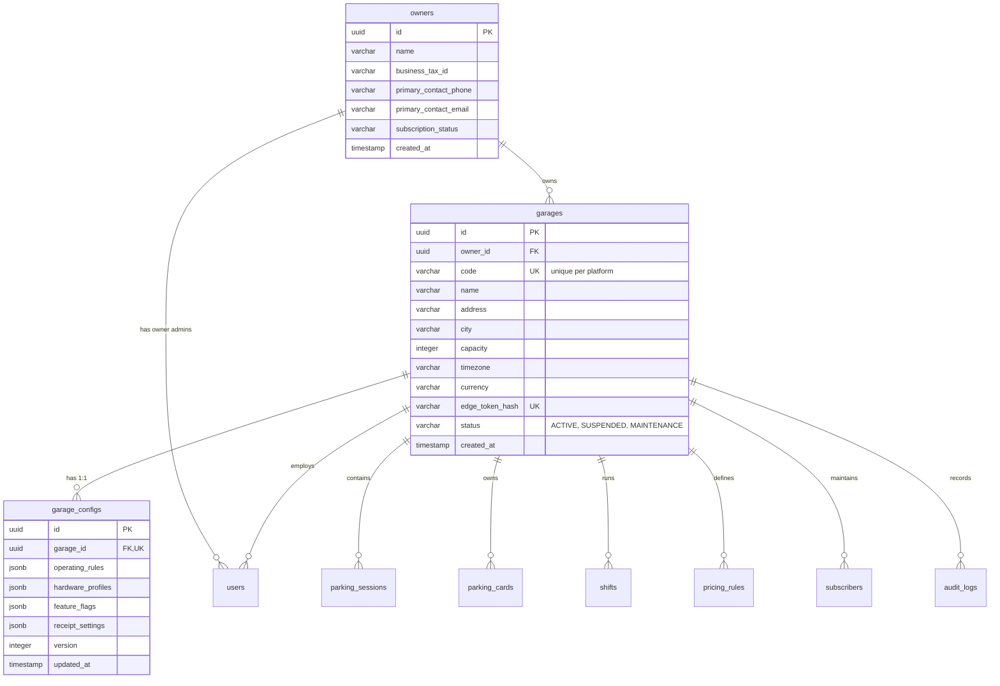
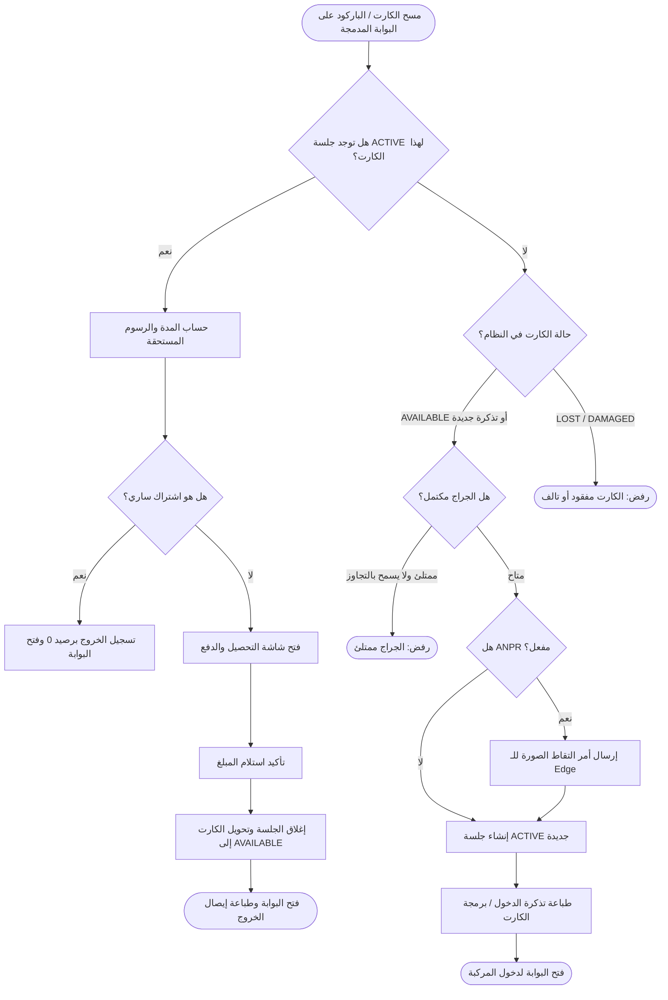
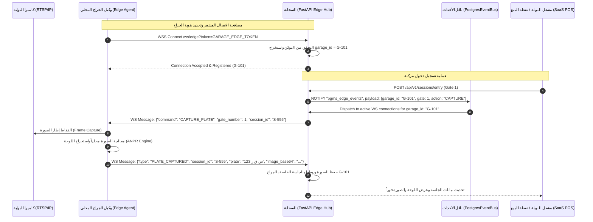
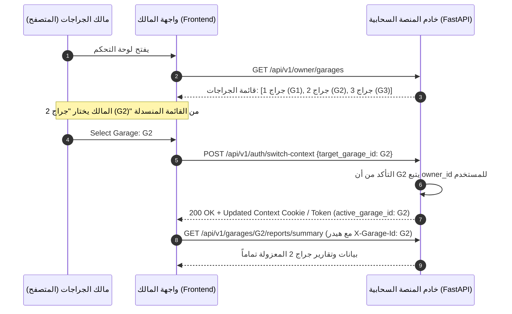

# مواصفة معمارية الانتقال إلى منصة SaaS السحابية متعددة الملاك والمستأجرين
# (Phase 5: Multi-Owner, Multi-Garage, Configuration-Driven SaaS Architecture Spec)

---

## 1. الرؤية المعمارية والأهداف (Architecture Vision & Core Goals)

تهدف هذه الوثيقة إلى وضع المواصفة الهندسية الشاملة لتحويل نظام إدارة الجراجات الحالي (PGMS) من نظام جراج فردي مُثبّت محلياً (Single-Tenant / On-Premise) إلى منصة سحابية متكاملة كخدمة (**Multi-Tenant, Multi-Owner, Configuration-Driven Cloud SaaS**).

### الأهداف الاستراتيجية:
1. **الهيكلية الهرمية متعددة المستويات (Hierarchical Multi-Tenancy):**
   فصل طبقة إدارة المنصة العامة (**Super Admin**) عن طبقة ملّاك المنشآت والشركات المشغلة (**Owners**)، وطبقة الجراجات الفردية التابعة لكل مالك (**Garages**)، وطبقة التشغيل الميداني للمديرين والمشغلين (**Managers & Operators**).
2. **عزل البيانات الصارم (Zero-Leakage Multi-Tenancy):**
   تطبيق معمارية قاعدة بيانات مشتركة ذات عزل منطقي صارم (Shared Database, Discriminator Column Architecture) مع ضمان التحقق على مستوى الـ API Dependencies و JWT Claims والاستعلامات (Repositories)، بحيث يستحيل تسرب بيانات جراج لآخر.
3. **محرك التخصيص الديناميكي الخالي من تعديل الكود (Configuration-Driven Engine):**
   كل جراج يمتلك ملف تكوين تشغيلي مستقل (`garage_config`) يتحكم في:
   - أنماط البوابات (منفصلة `ENTRY_ONLY` / `EXIT_ONLY` أو مدمجة `COMBINED`).
   - تنوع أجهزة وتيرمينال التشغيل (`DESKTOP_PC`، `SUNMI_POS`، `MOBILE_WEB`).
   - تفعيل/تعطيل الميزات الاختيارية (الكاميرات والـ ANPR، صورة الخروج، الاشتراكات الشهرية، بطاقات بلاستيكية مقابل تذاكر باركود ورقية، وإلزامية جرد الخزينة).
4. **تعدد المستأجرين في أجهزة الطرفية والـ Edge Agent (Multi-Tenant Edge Connectivity):**
   تأمين اتصال وكلاء الكاميرات المحليين (`edge_agent`) بالسحابة عبر WebSocket متعدد المستأجرين مع توجيه أوامر التقاط الصور حصرياً للجراج المعني عبر مسار الأحداث الموزعة (`PostgresEventBus`)، مع ضمان عدم تأثر أو استهلاك أي موارد للجراجات التي لا تستخدم كاميرات.

---

## 2. قصص المستخدمين والممثلين (Actors & User Stories)

### 2.1 الممثلون في النظام (System Actors)

| الممثل (Actor) | النطاق (Scope) | التعريف والدور |
| :--- | :--- | :--- |
| **Platform Super Admin** | المنصة بالكامل (Global) | مدير النظام والمنصة السحابية؛ يدير حسابات الملاك، يفعّل الجراجات الجديدة، يحدد باقات الاشتراك وحدود الموارد، ويراقب الحالة العامة للخدمة. |
| **Garage Owner** | مجموعة الجراجات التابعة لحسابه (`owner_id`) | مالك شركة أو مستثمر يمتلك جراجاً واحداً أو أسطولاً من الجراجات؛ يمتلك لوحة تحكم مجمعة، ويبدّل بين جراجاته لمتابعة التقارير والإيرادات والأداء. |
| **Garage Manager** | جراج محدد فقط (`garage_id`) | مدير الجراج المسؤول عن الورديات، تسعير الجراج، المشتركين، وإدارة المشغلين والبطاقات الخاصة بذلك الجراج حصراً. |
| **Gate Operator** | جراج محدد وبوابة محددة (`garage_id`, `gate_number`) | كاشير أو عامل البوابة المسؤول عن تسجيل دخول/خروج المركبات واستلام النقدية وطباعة الإيصالات وفقاً لملف التيرمينال الخاص به. |
| **Garage Edge Agent** | جراج محدد (`garage_id`) | برمجية خفيفة تعمل محلياً بجانب كاميرات البوابات، ترتبط بالسحابة عبر WebSocket مشفر بتوكن الجراج الخاص. |

---

### 2.2 قصص المستخدمين (User Stories)

#### US-SA-01: إدارة الملاك والجراجات (Super Admin)
> **بصفتي** سوبر أدمن للمنصة،  
> **أريد** إنشاء حسابات جديدة لملّاك الجراجات، وتعيين الجراجات التابعة لهم، وتفعيل/إيقاف ميزات كل جراج (مثل ANPR أو الاشتراكات)،  
> **حتى** أتمكن من بيع الخدمة كباقات تجارية ومراقبة الاستهلاك دون التدخل في العمليات اليومية للجراج.

#### US-OW-01: لوحة التحكم المجمعة ومبدّل الجراجات (Owner Overview & Switcher)
> **بصفتي** مالكاً لعدة جراجات (مثلاً: جراج التحرير، جراج المعادي، جراج التجمع)،  
> **أريد** واجهة موحدة تعرض إجمالي إيرادات أسطول الجراجات ومعدلات الإشغال اللحظية، مع إمكانية التبديل السلس بين الجراجات (`Garage Switcher`)،  
> **حتى** أتابع العمليات التفصيلية لأي جراج دون الحاجة إلى تسجيل الخروج والدخول بحسابات مختلفة.

#### US-MG-01: إدارة إعدادات وتشغيل الجراج المعزول (Garage Manager)
> **بصفتي** مدير جراج،  
> **أريد** ضبط قواعد التسعير، وإدارة المشتركين، وجرد الورديات، واستعراض سجل الجلسات والعمليات الخاصة بجراجي فقط،  
> **حتى** تسير الأعمال بدقة وأمان دون رؤية أي بيانات لأي جراج منافس أو تابع لنفس المالك لا أملك صلاحية عليه.

#### US-OP-01: تسجيل الحركات عبر بوابات مدمجة أو منفصلة (Gate Operator)
> **بصفتي** مشغل بوابة في جراج ذي مسار حركة واحد (Combined Gate)،  
> **أريد** عند تمرير باركود/كارت السيارة أن يفحص النظام تلقائياً: إذا لم تكن للسيارة جلسة مفتوحة يسجل دخولاً فورياً، وإذا كانت في جلسة مفتوحة يحسب السعر ويفتح نافذة الدفع والخروج،  
> **حتى** أتمكن من تشغيل البوابات الصغيرة ذات المسار المشترك بأعلى كفاءة وسرعة.

#### US-OP-02: التوافق مع ماكينات الكاشير المحمولة والموبايل (Hardware Adaptability)
> **بصفتي** مشغل جراج يعمل في الشارع أو ساحة مفتوحة بدون كابينة حاسوب مكتبي،  
> **أريد** تسجيل الدخول من جهاز كاشير محمول (مثل Sunmi V2s) أو موبايل لوحي، واستخدام كاميرا الجهاز لمسح التذاكر وطباعة الإيصال عبر الطابعة الحرارية المدمجة مباشرة بدون مربعات حوار إضافية،  
> **حتى** أقدم خدمة سريعة ميدانياً بمرونة تامة.

#### US-ED-01: التقاط الصور الآلي الآمن عبر السحابة (Edge Multi-Tenancy)
> **بصفتي** جراجاً مفعّلاً به نظام كاميرات ANPR،  
> **أريد** أن يتصل برنامج الكاميرات المحلي بالسحابة عبر توكن خاص بجراجي، وأن يتلقى إشارات التصوير الخاصة ببوابات جراجي فقط، وتُسجل الصور في جلسات جراجي،  
> **حتى** تعمل الكاميرات بسلاسة دون تعارض مع آلاف الكاميرات للجراجات الأخرى المرتبطة بنفس المنصة السحابية.

---

## 3. معمارية قاعدة البيانات والتعديلات الهيكلية (Database Architecture & Schema Changes)

### 3.1 النمط المعماري (Multi-Tenancy Model)
- **النمط المعتمد:** **Shared Database with Discriminator Column (`garage_id`)**.
- **الدافع الهندسي:**
  - سهولة الصيانة والمراقبة وتطبيق الترحيل الهيكلي (Alembic Migrations) دفعة واحدة.
  - تكلفة تشغيلية منخفضة للمنصة السحابية مع كفاءة تجميع الاتصالات (Connection Pooling via PgBouncer).
  - إمكانية استخراج تقارير مجمعة لمالك يمتلك 10 جراجات دون استعلامات معقدة عبر قواعد بيانات متعددة (Cross-Database Queries).
  - العزل الصارم مضمون بواسطة المفاتيح الخارجية، الفهارس الفريدة المركبة، ونطاق المستودعات الإلزامي (Mandatory Scoped Repositories).

---

### 3.2 الجداول الجديدة (New SaaS Core Tables)



#### 1. جدول الملاك (`owners`)
```sql
CREATE TABLE owners (
    id UUID PRIMARY KEY DEFAULT gen_random_uuid(),
    name VARCHAR(120) NOT NULL,
    company_name VARCHAR(150),
    business_registration_no VARCHAR(60),
    contact_phone VARCHAR(30) NOT NULL,
    contact_email VARCHAR(120) NOT NULL UNIQUE,
    subscription_plan VARCHAR(40) NOT NULL DEFAULT 'STANDARD', -- BASIC, PRO, ENTERPRISE
    billing_status VARCHAR(30) NOT NULL DEFAULT 'ACTIVE',      -- ACTIVE, TRIAL, PAST_DUE, CANCELLED
    max_garages_allowed INTEGER NOT NULL DEFAULT 1,
    created_at TIMESTAMPTZ NOT NULL DEFAULT CURRENT_TIMESTAMP,
    updated_at TIMESTAMPTZ NOT NULL DEFAULT CURRENT_TIMESTAMP
);

CREATE INDEX idx_owners_email ON owners(contact_email);
CREATE INDEX idx_owners_billing_status ON owners(billing_status);
```

#### 2. جدول الجراجات (`garages`)
```sql
CREATE TABLE garages (
    id UUID PRIMARY KEY DEFAULT gen_random_uuid(),
    owner_id UUID NOT NULL REFERENCES owners(id) ON DELETE RESTRICT,
    code VARCHAR(30) NOT NULL UNIQUE,                       -- رمز مختصر فريد (e.g., 'CAI-01', 'ALX-02')
    name VARCHAR(150) NOT NULL,
    address TEXT,
    city VARCHAR(60) NOT NULL DEFAULT 'Cairo',
    capacity INTEGER NOT NULL CHECK (capacity > 0),
    timezone VARCHAR(50) NOT NULL DEFAULT 'Africa/Cairo',
    currency VARCHAR(10) NOT NULL DEFAULT 'EGP',
    edge_token_hash VARCHAR(128) UNIQUE,                     -- لتأمين اتصال Edge Agent
    status VARCHAR(30) NOT NULL DEFAULT 'ACTIVE',            -- ACTIVE, SUSPENDED, INACTIVE
    created_at TIMESTAMPTZ NOT NULL DEFAULT CURRENT_TIMESTAMP,
    updated_at TIMESTAMPTZ NOT NULL DEFAULT CURRENT_TIMESTAMP
);

CREATE INDEX idx_garages_owner_id ON garages(owner_id);
CREATE INDEX idx_garages_code ON garages(code);
CREATE INDEX idx_garages_status ON garages(status);
```

#### 3. جدول تكوين الجراج الديناميكي (`garage_configs`)
```sql
CREATE TABLE garage_configs (
    id UUID PRIMARY KEY DEFAULT gen_random_uuid(),
    garage_id UUID NOT NULL UNIQUE REFERENCES garages(id) ON DELETE CASCADE,
    operating_rules JSONB NOT NULL DEFAULT '{}'::jsonb,
    hardware_profiles JSONB NOT NULL DEFAULT '{}'::jsonb,
    feature_flags JSONB NOT NULL DEFAULT '{}'::jsonb,
    receipt_settings JSONB NOT NULL DEFAULT '{}'::jsonb,
    version INTEGER NOT NULL DEFAULT 1,
    updated_at TIMESTAMPTZ NOT NULL DEFAULT CURRENT_TIMESTAMP
);

CREATE INDEX idx_garage_configs_garage_id ON garage_configs(garage_id);
```

---

### 3.3 تعديل الجداول التشغيلية الحالية وتطبيق `garage_id`

يتم تحويل كافة الجداول التشغيلية لتتضمن العمود التمييزي الإلزامي `garage_id` مع إعادة بناء الفهارس المركبة:

#### 1. جدول المستخدمين (`users`)
- إضافة `owner_id UUID NULL REFERENCES owners(id) ON DELETE CASCADE`
- إضافة `garage_id UUID NULL REFERENCES garages(id) ON DELETE SET NULL`
- تعديل الأدوار (`role`):
  - `SUPER_ADMIN`: `owner_id = NULL`, `garage_id = NULL`
  - `OWNER`: `owner_id NOT NULL`, `garage_id = NULL`
  - `MANAGER`: `owner_id = NULL` (مشتق), `garage_id NOT NULL`
  - `OPERATOR`: `owner_id = NULL`, `garage_id NOT NULL`, `gate_number NOT NULL`
- إسقاط القيد القديم `ck_users_role_gate_consistency` واستبداله بـ:
```sql
ALTER TABLE users ADD COLUMN owner_id UUID REFERENCES owners(id) ON DELETE CASCADE;
ALTER TABLE users ADD COLUMN garage_id UUID REFERENCES garages(id) ON DELETE CASCADE;

-- اسم المستخدم يجب أن يكون فريداً عالمياً أو مركباً حسب السياسة؛ الأفضل عالمياً
ALTER TABLE users ADD CONSTRAINT uq_users_username UNIQUE (username);

ALTER TABLE users DROP CONSTRAINT IF EXISTS ck_users_role_gate_consistency;
ALTER TABLE users ADD CONSTRAINT ck_users_role_hierarchy CHECK (
    (role = 'SUPER_ADMIN' AND owner_id IS NULL AND garage_id IS NULL AND gate_number IS NULL) OR
    (role = 'OWNER' AND owner_id IS NOT NULL AND garage_id IS NULL AND gate_number IS NULL) OR
    (role = 'MANAGER' AND garage_id IS NOT NULL AND gate_number IS NULL) OR
    (role = 'OPERATOR' AND garage_id IS NOT NULL AND gate_number IS NOT NULL)
);

CREATE INDEX idx_users_owner_id ON users(owner_id);
CREATE INDEX idx_users_garage_id ON users(garage_id);
```

#### 2. جدول كروت الجراج (`parking_cards`)
- البطاقات تتبع جراجاً محدداً (قد تتشابه أرقام الباركود بين جراجين مختلفين، لذا الفرادة تصبح مركبة):
```sql
ALTER TABLE parking_cards ADD COLUMN garage_id UUID NOT NULL REFERENCES garages(id) ON DELETE CASCADE;

-- إسقاط الفرادة العامة القديمة على card_code
ALTER TABLE parking_cards DROP CONSTRAINT IF EXISTS parking_cards_card_code_key;
ALTER TABLE parking_cards ADD CONSTRAINT uq_garage_card_code UNIQUE (garage_id, card_code);

CREATE INDEX idx_parking_cards_garage_status ON parking_cards(garage_id, status);
```

#### 3. جدول جلسات الاصطفاف (`parking_sessions`)
```sql
ALTER TABLE parking_sessions ADD COLUMN garage_id UUID NOT NULL REFERENCES garages(id) ON DELETE RESTRICT;

-- رقم الإيصال / الجلسة يعزل لكل جراج
CREATE INDEX idx_sessions_garage_status ON parking_sessions(garage_id, status);
CREATE INDEX idx_sessions_garage_entry_time ON parking_sessions(garage_id, entry_time);
CREATE INDEX idx_sessions_garage_plate ON parking_sessions(garage_id, plate_number);
CREATE INDEX idx_sessions_garage_shift ON parking_sessions(garage_id, entry_shift_id, exit_shift_id);
```

#### 4. جدول الورديات (`shifts`)
```sql
ALTER TABLE shifts ADD COLUMN garage_id UUID NOT NULL REFERENCES garages(id) ON DELETE RESTRICT;

CREATE INDEX idx_shifts_garage_status ON shifts(garage_id, status);
CREATE INDEX idx_shifts_garage_opened_at ON shifts(garage_id, opened_at);
```

#### 5. جدول قواعد التسعير (`pricing_rules`)
```sql
ALTER TABLE pricing_rules ADD COLUMN garage_id UUID NOT NULL REFERENCES garages(id) ON DELETE CASCADE;

-- لكل جراج شريحة تسعير خاصة بمركبته
CREATE INDEX idx_pricing_rules_garage_vehicle ON pricing_rules(garage_id, vehicle_type);
```

#### 6. جداول المشتركين والاشتراكات (`subscribers`, `subscription_plans`, `subscriptions`)
```sql
ALTER TABLE subscribers ADD COLUMN garage_id UUID NOT NULL REFERENCES garages(id) ON DELETE CASCADE;
ALTER TABLE subscription_plans ADD COLUMN garage_id UUID NOT NULL REFERENCES garages(id) ON DELETE CASCADE;
ALTER TABLE subscriptions ADD COLUMN garage_id UUID NOT NULL REFERENCES garages(id) ON DELETE CASCADE;

-- فرادة رقم الهوية أو الهاتف لكل جراج
ALTER TABLE subscribers DROP CONSTRAINT IF EXISTS subscribers_national_id_key;
ALTER TABLE subscribers ADD CONSTRAINT uq_garage_subscriber_phone UNIQUE (garage_id, phone);

CREATE INDEX idx_subscribers_garage ON subscribers(garage_id);
CREATE INDEX idx_subscriptions_garage_status ON subscriptions(garage_id, status);
```

#### 7. جدول سجل التدقيق (`audit_logs`)
```sql
ALTER TABLE audit_logs ADD COLUMN garage_id UUID NULL REFERENCES garages(id) ON DELETE SET NULL;
ALTER TABLE audit_logs ADD COLUMN owner_id UUID NULL REFERENCES owners(id) ON DELETE SET NULL;

CREATE INDEX idx_audit_logs_garage_created ON audit_logs(garage_id, created_at);
CREATE INDEX idx_audit_logs_owner_created ON audit_logs(owner_id, created_at);
```

---

## 4. استراتيجية العزل الصارم للبيانات (Strict Tenant & Garage Isolation)

### 4.1 عزل الـ Authentication و JWT Claims
يتم تشفير سياق الصلاحيات داخل الـ JWT Access Token وفق الهيكل التالي:

```json
{
  "sub": "user_uuid_1234",
  "username": "tahrir_manager",
  "role": "MANAGER",
  "owner_id": "owner_uuid_5678",
  "garage_id": "garage_uuid_9999",
  "active_garage_id": "garage_uuid_9999",
  "gate_number": null,
  "exp": 1792984000
}
```

#### مصفوفة الـ Claims حسب الدور:
| الدور | `owner_id` | `garage_id` (المعيّن) | `active_garage_id` (السياق الحالي) |
| :--- | :--- | :--- | :--- |
| `SUPER_ADMIN` | `null` | `null` | يمرر اختيارياً في الهيدر `X-Target-Garage-Id` للتشخيص والدعم الفني |
| `OWNER` | `uuid` | `null` | ديناميكي؛ يحدده المالك عبر الـ Garage Switcher ويُضمّن في Token الجلسة أو هيدر `X-Garage-Id` بعد التحقق من الملكية |
| `MANAGER` | مشتق من الجراج | `uuid` ثابت | يطابق `garage_id` دائماً، ولا يمكن تغييره |
| `OPERATOR` | مشتق من الجراج | `uuid` ثابت | يطابق `garage_id` دائماً، مقيد بـ `gate_number` |

---

### 4.2 طبقة الـ FastAPI Dependencies (Defense in Depth)

لمنع أي تسرب أو عبث يدوي بالمعرفات في الـ URLs، نعتمد سلسلة حقن تبعيات صارمة:

```python
# app/core/tenant_context.py

class TenantContext:
    def __init__(
        self,
        current_user: User,
        garage: Garage,
        garage_config: GarageConfig,
    ):
        self.user = current_user
        self.garage = garage
        self.garage_id = garage.id
        self.owner_id = garage.owner_id
        self.config = garage_config


async def get_tenant_context(
    request: Request,
    current_user: User = Depends(get_current_active_user),
    db: AsyncSession = Depends(get_db_session),
    x_garage_id: Optional[str] = Header(None, alias="X-Garage-Id"),
) -> TenantContext:
    """
    متحكم سياق الجراج الصارم:
    1. إذا كان المستخدم OPERATOR أو MANAGER:
       - garage_id مأخوذ حصراً من سجل المستخدم في قاعدة البيانات / JWT.
       - أي محاولة لإرسال X-Garage-Id مختلف ترفض بـ 403 Forbidden.
    2. إذا كان المستخدم OWNER:
       - يتطلب تحديد X-Garage-Id (أو active_garage_id في التوكن).
       - يتم فحص قاعدة البيانات للتأكد أن garage.owner_id == current_user.owner_id.
       - إذا لم يكن الجراج مملوكاً له، يرفض الطلب فوراً بـ 403 Forbidden.
    3. إذا كان SUPER_ADMIN:
       - يسمح له بالوصول لأي جراج عبر X-Garage-Id لأغراض الإشراف والمراقبة.
    """
```

---

### 4.3 عزل طبقة المستودعات (Scoped Repositories Pattern)

يُمنع منعاً باتاً استدعاء استعلام على الجداول التشغيلية دون تضمين شرط `WHERE garage_id = :current_garage_id`.

```python
# نمط BaseTenantRepository المعتمد
class BaseTenantRepository(Generic[ModelType]):
    def __init__(self, model: Type[ModelType], session: AsyncSession, garage_id: UUID):
        self.model = model
        self.session = session
        self.garage_id = garage_id

    def _base_query(self) -> Select:
        # حقن شرط العزل تلقائياً في صلب كل استعلام
        return select(self.model).where(self.model.garage_id == self.garage_id)

    async def get_by_id(self, entity_id: UUID) -> Optional[ModelType]:
        stmt = self._base_query().where(self.model.id == entity_id)
        result = await self.session.execute(stmt)
        return result.scalar_one_or_none()

    async def create(self, **kwargs) -> ModelType:
        # إسناد معرف الجراج إجبارياً من السياق لمنع التلاعب
        kwargs["garage_id"] = self.garage_id
        instance = self.model(**kwargs)
        self.session.add(instance)
        await self.session.flush()
        return instance
```

---

## 5. محرك تخصيص الجراجات الديناميكي (Per-Garage Dynamic Configuration Engine)

تخضع كافة سلوكيات النظام الميدانية لملف التكوين `garage_configs` بصيغة JSONB، ويتم التحقق منه بواسطة **Pydantic Schema**.

### 5.1 نموذج بيانات التكوين (Configuration JSON Schema)

```json
{
  "$schema": "http://json-schema.org/draft-07/schema#",
  "title": "GarageConfiguration",
  "type": "object",
  "required": ["operating_rules", "hardware_profiles", "feature_flags", "receipt_settings"],
  "properties": {
    "operating_rules": {
      "type": "object",
      "required": ["gate_topology", "grace_period_minutes", "lost_ticket_fee"],
      "properties": {
        "gate_topology": {
          "type": "string",
          "enum": ["SEPARATED_GATES", "COMBINED_GATES"],
          "description": "SEPARATED: بوابات منفصلة للدخول والخروج. COMBINED: بوابة مدمجة مشتركة لنفس المسار"
        },
        "gates": {
          "type": "array",
          "items": {
            "type": "object",
            "required": ["gate_number", "gate_type", "name"],
            "properties": {
              "gate_number": { "type": "integer" },
              "gate_type": { "type": "string", "enum": ["ENTRY_ONLY", "EXIT_ONLY", "COMBINED"] },
              "name": { "type": "string" },
              "default_terminal_profile": { "type": "string", "enum": ["DESKTOP_PC", "SUNMI_POS", "MOBILE_WEB"] }
            }
          }
        },
        "grace_period_minutes": { "type": "integer", "minimum": 0, "default": 15 },
        "lost_ticket_fee": { "type": "integer", "minimum": 0, "default": 50 },
        "allow_manual_exit_plate_entry": { "type": "boolean", "default": true }
      }
    },
    "hardware_profiles": {
      "type": "object",
      "required": ["default_profile"],
      "properties": {
        "default_profile": {
          "type": "string",
          "enum": ["DESKTOP_PC", "SUNMI_POS", "MOBILE_WEB"]
        },
        "profiles": {
          "type": "object",
          "properties": {
            "DESKTOP_PC": {
              "type": "object",
              "properties": {
                "scanner_input_type": { "type": "string", "enum": ["KEYBOARD_WEDGE", "SERIAL_COM"] },
                "printer_paper_width_mm": { "type": "integer", "enum": [80, 58], "default": 80 },
                "auto_print_receipt": { "type": "boolean", "default": true },
                "sound_alerts_enabled": { "type": "boolean", "default": true }
              }
            },
            "SUNMI_POS": {
              "type": "object",
              "properties": {
                "printer_paper_width_mm": { "type": "integer", "enum": [58], "default": 58 },
                "integrated_scanner_enabled": { "type": "boolean", "default": true },
                "sunmi_printer_cut_paper": { "type": "boolean", "default": false },
                "high_contrast_touch_ui": { "type": "boolean", "default": true }
              }
            },
            "MOBILE_WEB": {
              "type": "object",
              "properties": {
                "camera_scanner_library": { "type": "string", "default": "html5-qrcode" },
                "vibrate_on_scan": { "type": "boolean", "default": true },
                "bluetooth_printer_mac": { "type": "string", "nullable": true }
              }
            }
          }
        }
      }
    },
    "feature_flags": {
      "type": "object",
      "required": ["anpr_enabled", "exit_photo_enabled", "subscriptions_enabled", "ticket_system", "require_shift_cash_reconciliation"],
      "properties": {
        "anpr_enabled": { "type": "boolean", "description": "تفعيل التعرف التلقائي على اللوحات وتصوير الدخول" },
        "exit_photo_enabled": { "type": "boolean", "description": "تفعيل كاميرا الخروج لمقارنة صورة الدخول والخروج" },
        "subscriptions_enabled": { "type": "boolean", "description": "إتاحة إدارة المشتركين والخطط الشهرية" },
        "ticket_system": {
          "type": "string",
          "enum": ["REUSABLE_CARDS", "PAPER_BARCODE_TICKETS"],
          "description": "نوع التذاكر المستخدمة: كروت بلاستيكية ذكية يعاد تدويرها أو تذاكر ورقية ذات استخدام واحد"
        },
        "require_shift_cash_reconciliation": {
          "type": "boolean",
          "description": "إلزام المشغل بإدخال النقدية الفعلية ومطابقة العجز/الزيادة عند إغلاق الوردية"
        },
        "allow_overcapacity_entry": { "type": "boolean", "default": false },
        "allow_discount_override": { "type": "boolean", "default": false }
      }
    },
    "receipt_settings": {
      "type": "object",
      "properties": {
        "header_title": { "type": "string" },
        "header_subtitle": { "type": "string" },
        "footer_terms": { "type": "string" },
        "show_qr_code": { "type": "boolean", "default": true },
        "show_tax_number": { "type": "boolean", "default": false },
        "tax_registration_no": { "type": "string" }
      }
    }
  }
}
```

---

### 5.2 منطق أنماط البوابات (Gate Topology Execution Logic)

#### 1. نمط البوابات المنفصلة (`SEPARATED_GATES`):
- بوابات الدخول (`ENTRY_ONLY`):
  - تقبل فقط مسح كارت متاح (`AVAILABLE`) أو توليد تذكرة ورقية جديدة.
  - إذا تم مسح كارت في جلسة نشطة بالفعل، يرفض النظام العملية مع رسالة تنبيه: `"هذا الكارت مسجل دخول بالفعل داخل الجراج"`.
- بوابات الخروج (`EXIT_ONLY`):
  - تقبل فقط مسح كارت ذي جلسة نشطة (`ACTIVE`).
  - تحسب الرسوم وفق القواعد، وتستقبل الدفع، وتغلق الجلسة.
  - إذا تم مسح كارت غير نشط أو تذكرة غير موجودة، يُرفض الطلب: `"لا توجد جلسة اصطفاف نشطة لهذا الكارت"`.

#### 2. نمط البوابات المدمجة المشتركة (`COMBINED`):
البوابة الواحدة في الجراج تعمل كمسار مزدوج للمسح السريع (Dual-Action Scanner Engine):



---

### 5.3 ملفات الأجهزة والتيرمينال (Hardware Terminal Profiles)

يتكيف كود الواجهة الأمامية (HTML/JS) تلقائياً بمجرد استلام ملف التكوين الخاص بالبوابة والمشغل:

| الجانب التشغيلي | سطح المكتب (`DESKTOP_PC`) | كاشير محمول (`SUNMI_POS`) | ويب الموبايل (`MOBILE_WEB`) |
| :--- | :--- | :--- | :--- |
| **جهاز الإدخال (Scanner)** | Keyboard Wedge (ماسح ضوئي USB سلكي أو لاسلكي) يتصرف كلوحة مفاتيح مركزة على حقل خفي. | الماسح الداخلي لـ Sunmi عبر Android Broadcast Intent أو SDK المدمج. | تشغيل كاميرا الهاتف مباشرة عبر مكتبة `html5-qrcode` في الواجهة. |
| **الطباعة (Printing)** | نافذة طباعة المتصفح السريعة أو إرسال أوامر خام عبر بروتوكول محلي (Raw ESC/POS 80mm). | الاتصال بـ `SunmiPrinterPlugin` عبر JavaScript Interface المباشر (58mm تلقائي بدون نافذة تأكيد). | طباعة عبر Bluetooth ESC/POS المحمول أو إظهار تذكرة إلكترونية قابلة للحفظ كصورة / PDF. |
| **تصميم الواجهة (UX/UI)** | شاشة عريضة منقسمة: جانب الكاميرات والبوابات، وجانب ملخص الوردية، وأزرار الاختصار السريعة (F1-F12). | شاشة طولية عالية التباين، أزرار لمس كبيرة جداً مناسبة للأصابع في الشمس، وعملية بنقرة واحدة (One-Tap Checkout). | تصميم متجاوب فائق الخفة (Responsive Mobile-First PWA) متوافق مع كافة أحجام الهواتف والشاشات اللمسية. |
| **التنبيهات الصوتية** | تشغيل ملفات صوتية واضحة عبر Web Audio API لأصوات التأكيد والخطأ. | اهتزاز الجهاز (Haptic Feedback) بالإضافة إلى نغمة تنبيه Sunmi Hardware Beeper. | اهتزاز المتصفح عبر `navigator.vibrate([100, 50, 100])`. |

---

## 6. معمارية ربط الكاميرات والـ Edge Agent في بيئة الـ SaaS

في بيئة الـ SaaS السحابية، لا تمتلك خوادم السحابة وصولاً مباشراً لشبكات الـ LAN المحلية للجراجات. لذا نعتمد معمارية **Outbound Reverse Tunnel over WebSocket**.

### 6.1 المعمارية العامة ومسار البيانات



---

### 6.2 أمان وتوجيه الـ Edge Agent (Authentication & Multiplexing)

1. **مفتاح الاتصال الخاص بكل جراج (`garage_edge_token`):**
   - لكل جراج مفتاح فريد مشفر يتم توليده عند إنشاء الجراج، مثل: `edge_live_sec_a8f92b7...`.
   - يتم تخزين تجزئة المفتاح (SHA-256 Hash) في جدول `garages.edge_token_hash`.
   - عند طلب الاتصال بـ `/ws/edge`:
     ```python
     @router.websocket("/ws/edge")
     async def edge_websocket_endpoint(
         websocket: WebSocket,
         token: str = Query(...),
         db: AsyncSession = Depends(get_db_session)
     ):
         garage = await authenticate_edge_token(token, db)
         if not garage:
             await websocket.close(code=status.WS_1008_POLICY_VIOLATION)
             return
         
         # تسجيل الاتصال داخل مدير الاتصالات السحابي
         await edge_hub_manager.connect(garage_id=garage.id, websocket=websocket)
     ```

2. **مدير الاتصالات (`EdgeHubManager`):**
   - يحتفظ بجدول اتصالات نشطة متعدد المستأجرين في ذاكرة السحابة:
     ```python
     # Dict[UUID, Set[WebSocket]]
     self.active_garage_connections = defaultdict(set)
     ```
   - عند إرسال أي إشارة التقاط أو فحص صحة (Health Ping)، تُرسل الرسالة حصرياً إلى الاتصالات التابعة لنفس الـ `garage_id`.

3. **التكامل مع ناقل الأحداث (`PostgresEventBus`):**
   - لتشغيل السحابة عبر عدة خوادم ونسخ (Multi-Worker Scalability)، يتم تضمين `garage_id` داخل حمولة الحدث `JSON`:
     ```json
     {
       "event_type": "EDGE_COMMAND_TRIGGER",
       "garage_id": "c7a8b3d2-4e5f-4a1b-8c2d-9e0f1a2b3c4d",
       "gate_number": 1,
       "command": "CAPTURE_PHOTO",
       "timestamp": "2026-10-25T23:59:00Z"
     }
     ```
   - العامل (Worker) الذي يستلم إشعار PostgreSQL يفحص ما إذا كان اتصال الـ WebSocket الخاص بهذا الـ `garage_id` مسجلاً لديه، ثم يمرر الأمر إليه.

4. **مبدأ عدم التأثير على الجراجات التي لا تستخدم كاميرات (Zero Overhead for Non-ANPR):**
   - إذا كان إعداد الجراج `feature_flags.anpr_enabled == false`:
     - يتم تجاهل إرسال أي أحداث عبر الـ EventBus نهائياً.
     - تنتهي عملية تسجيل الدخول أو الخروج في زمن استجابة قياسي (< 15 ملي ثانية).
     - لا ينتظر النظام أي صور، وتُنشأ الجلسة فوراً بالحقول الافتراضية.

---

## 7. مصفوفة الصلاحيات وخارطة الـ API (RBAC Matrix & API Routing)

### 7.1 مصفوفة الصلاحيات (Role-Based Access Control)

| المورد / الإجراء (Endpoint Action) | Super Admin | Owner | Garage Manager | Gate Operator |
| :--- | :---: | :---: | :---: | :---: |
| **إدارة حسابات الملاك والاشتراكات السحابية** | ✅ كامل | ❌ | ❌ | ❌ |
| **إنشاء جراج جديد وتوليد توكن الـ Edge** | ✅ كامل | ❌ (أو بطلب شراء) | ❌ | ❌ |
| **تعديل إعدادات التكوين والميزات (`garage_configs`)** | ✅ كامل | ✅ لجراجاته | ⚠️ قراءة فقط | ❌ |
| **لوحة التحكم المجمعة لأسطول الجراجات** | ✅ رؤية شاملة | ✅ لجراجاته فقط | ❌ | ❌ |
| **لوحة تحكم الجراج الفردي والتقارير** | ✅ للتشخيص | ✅ عبر Switcher | ✅ كاملة لجراجه | ❌ |
| **إدارة المستخدمين والمشغلين** | ✅ كامل المنصة | ✅ لموظفي جراجاته | ✅ لمشغلي جراجه | ❌ |
| **إدارة خطط التسعير والاشتراكات** | ✅ | ✅ لجراجاته | ✅ لجراجه | ❌ |
| **فتح وإغلاق وإدارة الورديات (`shifts`)** | ❌ (مراقبة فقط) | 👁️ استعراض | ✅ إشراف واعتماد | ✅ فتح/إغلاق ورديته |
| **تسجيل حركات الدخول والخروج والتحصيل** | ❌ | ❌ | ⚠️ استثنائي للإنقاذ | ✅ تشغيل يومي |
| **إلغاء جلسة أو تعديل رسوم يدوياً** | ✅ للتدقيق | ✅ | ✅ بصلاحية خاصة | ❌ |

---

### 7.2 هيكل مسارات واجهات برمجة التطبيقات (API Routing Architecture)

```
/api/v1/
│
├── platform/                          # [SUPER_ADMIN ONLY]
│   ├── owners/                        # CRUD للملاك وبياناتهم التجارية
│   ├── garages/                       # إنشاء وتفعيل الجراجات وحصصها
│   ├── subscriptions/                 # باقات واشتراكات المنصة السحابية
│   └── metrics/                       # إحصائيات النظام ومعدل استهلاك الموارد
│
├── owner/                             # [OWNER ONLY]
│   ├── dashboard/overview             # تقرير مجمع لكل الجراجات التابعة للمالك
│   ├── garages/                       # قائمة الجراجات المملوكة للتبديل بينها
│   └── audits/                        # سجل تدقيق العمليات الحساسة في جراجاته
│
└── garages/{garage_id}/               # [SCOPED TENANT API - Strict Isolation]
    │   (يخضع لتحقق get_tenant_context إجبارياً)
    ├── config/                        # استرجاع وتحديث تكوين الجراج الديناميكي
    ├── sessions/                      # إدارة وحركات الاصطفاف (Entry, Exit, Combined)
    ├── cards/                         # إدارة البطاقات وتخصيص الباركود
    ├── shifts/                        # إدارة الورديات والجرد النقدي
    ├── pricing/                       # قواعد التسعير الخاصة بالجراج
    ├── subscribers/                   # المشتركون والاشتراكات الشهرية
    ├── reports/                       # تقارير الجراج (إيرادات، إشغال، حركة)
    └── edge/                          # فحص حالة الـ Edge Agent والكاميرات
```

---

## 8. تدفق العمليات وحالات الاستخدام المعقدة (Workflows & Edge Cases)

### 8.1 تدفق استخدام مبدل الجراجات للمالك (Owner Garage Switcher Flow)



---

### 8.2 حالات الحافة وإجراءات السلامة التشغيلية (Edge Cases & Safety Mitigations)

#### 1. مسح كارت تابع لجراج آخر (Cross-Tenant Card Scanned):
- **السيناريو:** عميل يحمل كارت/تذكرة من "جراج المعادي" وقام بتمريرها على بوابة "جراج التحرير".
- **المعالجة:** بما أن البحث يتم بواسطة `WHERE garage_id = :current_garage_id AND card_code = :scanned_code`:
  - لن يجد النظام الكارت في جراج التحرير، وسيعيد خطأ فوري: `"الكارت غير مسجل في هذا الجراج"`.
  - لن يحدث أي تداخل أو تسرب لأي بيانات بين الجراجين.

#### 2. انقطاع اتصال الإنترنت المحلي والـ Edge Agent:
- **السيناريو:** انقطاع خدمة الإنترنت في كابينة الجراج المحلي التي تستخدم الكاميرات.
- **المعالجة:**
  - واجهة البيع السحابية تفحص حالة اتصال الـ Edge عبر WebSocket.
  - في حال انقطاع الـ Edge، تُظهر الواجهة تحذيراً فورياً مع تفعيل وضع الإدخال اليدوي التلقائي للوحة السيارة (`Fallback to Manual Plate Entry`).
  - تستمر عمليات الدخول والخروج والتحصيل دون توقف، وتُسجل الحركة بملاحظة `"Edge Offline - Manual Entry"`.

#### 3. البوابة المدمجة: كارت مفقود أو عالق في جلسة من شهور:
- **السيناريو:** سائق يمرر كارتاً تم نسيانه في جلسة قديمة جداً على بوابة مدمجة.
- **المعالجة:**
  - محرك البوابة المدمجة يحسب المدة والرسوم. إذا تجاوزت الرسوم الحد الأقصى أو كان الكارت مفقوداً (`LOST`)، يُمنع فتح البوابة تلقائياً ويُوجه المشغل إلى شاشة تسوية المشاكل (`Dispute / Lost Ticket Modal`) لتطبيق رسوم التذكرة المفقودة المحددة في `operating_rules.lost_ticket_fee`.

#### 4. محاولة مشغل بوابة الوصول إلى جراج آخر عبر تعديل عنوان الـ URL:
- **السيناريو:** مشغل في جراج A قام بتغيير الـ URL يدوياً إلى `/garages/UUID-B/...`.
- **المعالجة:**
  - تفشل التبعية `get_tenant_context` فوراً لأن `current_user.garage_id != requested_garage_id`.
  - يُسجل الحادث كاختراق أمني في `audit_logs` مع نوع `UNAUTHORIZED_TENANT_ACCESS_ATTEMPT`.
  - يُعاد رد `403 Forbidden` فوري مع إنهاء الجلسة.

#### 5. إغلاق وردية في ظل وجود جرد إلزامي معطل بالتهيئة:
- **السيناريو:** جراج ألغى شرط جرد الخزينة في تكوينه (`require_shift_cash_reconciliation = false`).
- **المعالجة:**
  - واجهة إغلاق الوردية تخفي حقول إدخال الفئات النقدية وعجز/زيادة الخزينة وتسمح للمشغل بالإغلاق بضغطة زر واحدة، مع تسجيل إجمالي النظام المحسوب آلياً.

---

## 9. خطة الترحيل المعماري (Migration Architecture Plan)

لضمان الانتقال السلس للبيانات الحالية في النظام (Zero-Downtime Data Migration):

1. **الخطوة الأولى (إنشاء الجداول التأسيسية):**
   - إنشاء جداول `owners` و `garages` و `garage_configs`.
2. **الخطوة الثانية (إنشاء المالك والجراج الافتراضي):**
   - إدراج مالك تجريبي افتراضي (`Default System Owner`).
   - إدراج جراج افتراضي يمثل النظام الحالي (`Main Garage - CAI-01`).
   - توليد تكوين افتراضي في `garage_configs` يماثل السلوك الحالي للنظام.
3. **الخطوة الثالثة (حقن `garage_id` في البيانات الحالية):**
   - إضافة العمود `garage_id` كعمود اختياري (Nullable) أولاً في جميع الجداول التشغيلية.
   - تشغيل سكريبت ترحيل بيانات ينفذ: `UPDATE <table_name> SET garage_id = :default_garage_id WHERE garage_id IS NULL`.
   - تعديل العمود ليصبح إلزامياً (`NOT NULL`) مع إضافة القيود والمفاتيح الخارجية.
4. **الخطوة الرابعة (تعديل صلاحيات المستخدمين الحاليين):**
   - ترقية المستخدم `admin` الحالي ليصبح مالكاً أو مديراً للجراج الافتراضي.
   - ربط جميع مشغلي البوابات بالجراج الافتراضي.

---

## 10. ملخص التحقق المعماري (Architectural Compliance Checklist)

- [x] **فصل وتحديد مستويات المستخدمين:** Super Admin، Owner، Garage Manager، Gate Operator.
- [x] **تأمين العزل التام للبيانات:** عزل على مستوى قاعدة البيانات، الـ JWT، والـ Repository.
- [x] **تغطية أنماط البوابات:** بوابات منفصلة (`ENTRY_ONLY` / `EXIT_ONLY`) وبوابات مدمجة (`COMBINED`).
- [x] **تنوع الأجهزة والتيرمينال:** ملفات حاسوب مكتبي، ماكينات Sunmi POS، وواجهات ويب الموبايل.
- [x] **ميزات قابلة للتفعيل والتعطيل:** الكاميرات (ANPR)، صورة الخروج، الاشتراكات، نوع التذاكر، وجرد الخزينة.
- [x] **اتصال آمن ومتعدد المستأجرين للـ Edge:** توكن فريد لكل جراج، ناقل أحداث معزول بالـ `garage_id`، وصفر تأثير على الجراجات التي لا تستخدم كاميرات.
- [x] **هيكل توثيق شامل:** يشمل قصص المستخدمين، مخططات ERD وتسلسل العمليات، ومصفوفة الصلاحيات، وحالات الحافة.
